# DATABASE_ARCHITECTURE.md

## College Student Management & Administrative Data System

**Stack:** Django + Django REST Framework + PostgreSQL prod / SQLite dev (Modular Monolith)
**Date:** 2026-09-06 (synced 2026-09-08 to prototype)
**Governing documents:** `ARCHITECTURE.md`, `DECISIONS.md`, `master_architectural_prompt_student_management.md`

> **DB engine (prototype):** `backend/config/settings.py` defaults to SQLite (`DB_ENGINE=sqlite`, `backend/db.sqlite3`)
> for local dev; `DB_ENGINE=postgresql` + `docker-compose.yml` (`postgres:16-alpine`) for prod parity.
> PostgreSQL types below (UUID, JSONB, GIN trigram) are authoritative; SQLite is dev-only convenience.

> **Reconciliation rule:** Where the master database prompt conflicts with ARCHITECTURE.md / DECISIONS.md, the latter takes priority — they reflect decisions made after the prompt was written. Specific reconciliation points (ADR-007, ADR-010, ADR-011, ADR-013, ADR-015, ADR-016, ADR-022, ADR-023) are called out inline.

---

## Deliverable A — Domain & Bounded-Context Map

### Bounded Contexts (per ADR-002)

```
┌─────────────────────────────────────────────────────────────────────┐
│                        MODULAR MONOLITH                            │
│                                                                     │
│  ┌─────────────────┐                                                │
│  │  Identity &      │◄──── all protected modules depend on this     │
│  │  Access          │                                                │
│  └────────┬─────────┘                                                │
│           │                                                          │
│  ┌────────▼─────────┐                                                │
│  │  Academic         │◄── Student Mgmt, Faculty, Finance, Results    │
│  │  Foundation       │                                                │
│  └────────┬─────────┘                                                │
│           │                                                          │
│  ┌────────▼─────────┐    ┌──────────────┐    ┌──────────────┐       │
│  │  Student          │◄───│  Onboarding  │    │  Faculty &   │       │
│  │  Management       │    │  & Import    │    │  Assignment  │       │
│  └──┬───┬───┬───┬───┘    └──────────────┘    └──────────────┘       │
│     │   │   │   │                                                    │
│     │   │   │   └─────────────────────────────┐                      │
│     │   │   └──────────┐                      │                      │
│     │   │              │                      │                      │
│  ┌──▼───▼──┐   ┌──────▼──────┐   ┌──────────▼──────┐               │
│  │Verifica- │   │  Documents  │   │  Results &      │               │
│  │tion      │   │             │   │  Eligibility    │               │
│  └──────────┘   └─────────────┘   └────────┬────────┘               │
│                                            │                         │
│  ┌──────────────┐    ┌──────────────┐      │                         │
│  │  Finance      │    │  Student     │      │                         │
│  │               │    │  Services    │      │                         │
│  └──────┬────────┘    └──────────────┘      │                         │
│         │                                    │                         │
│  ┌──────▼────────────────────────────────────▼──────┐                │
│  │              Reporting & Analytics                │                │
│  │         (read-only, downstream consumer)          │                │
│  └──────────────────────┬───────────────────────────┘                │
│                         │                                             │
│  ┌──────────────────────▼───────────────────────────┐                │
│  │              Audit & Observability                │                │
│  │         (cross-cutting supporting capability)     │                │
│  └──────────────────────────────────────────────────┘                │
└─────────────────────────────────────────────────────────────────────┘
```

### Module Ownership Summary

| Module | Owns |
|---|---|
| **Identity & Access** | Users, Roles, Permissions, Authentication, JWT, Account provisioning |
| **Academic Foundation** | Departments, Programs, Academic Years, Semesters, Batches, Schemes, Subjects, Scheme Subjects, Department Intakes |
| **Student Management** | Student identity, Admissions, Addresses, Categories, Bank accounts, Enrollments, Scholarships, Educational history, Student lifecycle |
| **Onboarding & Import** | Import batches, Staging rows, Validation, Normalization, Deduplication, Import state |
| **Verification** | Verification workflows, Decisions, Correction requests, Verification history |
| **Documents** | Document metadata, Versions, Storage references, Document lifecycle |
| **Faculty & Assignment** | Faculty records, Teaching assignments, Subject/batch assignments, Academic portfolio via `faculty_academic_items` (`PUBLICATION/PATENT/BOOK/AWARD/MEMBERSHIP/CONSULTANCY/GUIDANCE` + JSON `details`) — prototype deviation from 7-table master-prompt design, see D.7 |
| **Assessments (separate Django app, logically under Results & Eligibility)** | Assessment types, Assessments, Assessment marks (`DRAFT/PUBLISHED/LOCKED`) — owned by `apps.assessments`, FKs into Academic Foundation |
| **Results & Eligibility** | Result import batches/rows, Student results + details, Result correction requests + audits, Student credits, Eligibility rules/decisions, Next-year promotion lists |
| **Finance** | Fee heads, Fee structures, Fee structure items, Student fee accounts, Fee charges, Payment ledger entries + reversals |
| **Student Services** | Service request types, Service requests, Service request audits (append-only) |
| **Reporting & Analytics** | Read-only; no owned business data |
| **Audit & Observability** | Audit log entries, Sensitive-data access log |

### Reconciliation: ADR-011 (Corrections are cross-cutting, not a module)

There is **no Correction Module** in the bounded-context map. Each module implements its own correction semantics:

- Student Management → additive data correction (government-data pattern)
- Finance → append-only reversal/correction ledger entries
- Results → result supersession (V1 → V2)
- Documents → document replacement (V1 SUPERSEDED → V2 CURRENT)
- Verification → historical decision trail (never silently rewritten)

---

## Deliverable B — Source-of-Truth Map

| Business Fact | Authoritative Table | Owner Module |
|---|---|---|
| User identity / credentials | `users` | Identity & Access |
| Role definitions | `roles` | Identity & Access |
| Permissions | `permissions` | Identity & Access |
| User-role assignments | `user_roles` | Identity & Access |
| Role-permission assignments | `role_permissions` | Identity & Access |
| Department structure | `departments` | Academic Foundation |
| Program definitions | `programs` | Academic Foundation |
| Academic year lifecycle | `academic_years` | Academic Foundation |
| Semester definitions | `semesters` | Academic Foundation |
| Batch definitions | `batches` | Academic Foundation |
| Scheme / curriculum | `schemes` | Academic Foundation |
| Subject identity | `subjects` | Academic Foundation |
| Subject-under-scheme | `scheme_subjects` | Academic Foundation |
| Department intake | `department_intakes` | Academic Foundation |
| Student canonical identity | `students` | Student Management |
| Student admission data | `student_admissions` | Student Management |
| Student addresses | `student_addresses` | Student Management |
| Student category / reservation | `student_categories` | Student Management |
| Student bank accounts | `student_bank_accounts` | Student Management |
| Student educational history | `student_educational_histories` | Student Management |
| Student scholarships | `student_scholarships` | Student Management |
| Student enrollment state (authoritative) | `student_enrollments` | Student Management |
| Government-data corrections | `student_data_corrections` | Student Management |
| Import batch lifecycle | `import_batches` | Onboarding |
| Import staging rows | `import_staging_rows` | Onboarding |
| Verification decisions | `verification_requests` | Verification |
| Verification decision history | `verification_decisions` | Verification |
| Student documents | `student_documents` | Documents |
| Faculty documents | `faculty_documents` *(NOT IMPLEMENTED — deferred to future iteration)* | Documents |
| Faculty identity | `faculty` | Faculty |
| Faculty teaching assignments | `faculty_assignments` | Faculty |
| Faculty accreditations (generic prototype) | `faculty_academic_items` | Faculty |
| Assessment types | `assessment_types` | Assessments (separate app) |
| Assessments | `assessments` | Assessments (separate app) |
| Assessment marks | `assessment_marks` | Assessments (separate app) |
| Result import batches | `result_import_batches` | Results & Eligibility |
| Result import rows | `result_import_rows` | Results & Eligibility |
| Student results | `student_results` | Results & Eligibility |
| Student result details | `student_result_details` | Results & Eligibility |
| Result correction requests | `result_correction_requests` | Results & Eligibility |
| Result correction audits | `result_correction_audits` | Results & Eligibility |
| Student credits | `student_credits` | Results & Eligibility |
| Eligibility rules | `eligibility_rules` | Results & Eligibility |
| Eligibility decisions | `eligibility_decisions` | Results & Eligibility |
| Next-year promotion lists | `next_year_eligibility_lists` | Results & Eligibility |
| Fee heads | `fee_heads` | Finance |
| Fee structures | `fee_structures` | Finance |
| Fee structure items | `fee_structure_items` | Finance |
| Student fee accounts | `student_fee_accounts` | Finance |
| Student fee charges | `fee_charges` | Finance |
| Payment ledger entries | `payment_ledger_entries` | Finance |
| Service request types | `service_request_types` | Student Services |
| Service requests | `service_requests` | Student Services |
| Service request audits | `service_request_audits` | Student Services |
| Register / dashboards | — (no tables; read-only projection via module query services) | Register |
| Audit log | `audit_log` | Audit |
| Sensitive-data access log | `sensitive_data_access_log` | Audit |

---

## Deliverable C — Complete ERD

```mermaid
erDiagram
    %% ── Identity & Access ──
    users ||--o{ user_roles : "has"
    roles ||--o{ user_roles : "assigned to"
    roles ||--o{ role_permissions : "grants"
    permissions ||--o{ role_permissions : "granted by"

    %% ── Academic Foundation ──
    departments ||--o{ programs : "offers"
    departments ||--o{ batches : "organizes"
    departments ||--o{ department_intakes : "defines capacity"
    programs ||--o{ schemes : "follows"
    programs ||--o{ student_admissions : "admitted to"
    academic_years ||--o{ semesters : "contains"
    academic_years ||--o{ department_intakes : "for year"
    schemes ||--o{ scheme_subjects : "includes"
    subjects ||--o{ scheme_subjects : "used in"

    %% ── Student Management ──
    students ||--o| student_addresses : "lives at"
    students ||--o| student_categories : "classified as"
    students ||--o| student_bank_accounts : "banking"
    students ||--o{ student_admissions : "admitted"
    students ||--o{ student_enrollments : "enrolled"
    students ||--o{ student_scholarships : "receives"
    students ||--o{ student_educational_histories : "prior education"
    students ||--o{ student_data_corrections : "corrected"
    student_enrollments }o--|| academic_years : "in year"
    student_enrollments }o--|| semesters : "in semester"
    student_enrollments }o--|| departments : "in dept"
    student_enrollments }o--|| programs : "in program"
    student_enrollments }o--|| batches : "in batch"
    student_enrollments }o--|| schemes : "under scheme"

    %% ── Onboarding ──
    import_batches ||--o{ import_staging_rows : "contains"
    import_staging_rows }o--o| students : "matched to"

    %% ── Verification ──
    verification_requests }o--|| students : "about"
    verification_requests ||--o{ verification_decisions : "decided by"

    %% ── Documents ──
    student_documents }o--|| students : "belongs to"
    faculty_documents }o--|| faculty : "belongs to"

    %% ── Faculty (prototype: generic academic items) ──
    faculty ||--o{ faculty_assignments : "teaches"
    faculty_assignments }o--|| scheme_subjects : "subject"
    faculty_assignments }o--|| academic_years : "in year"
    faculty_assignments }o--|| semesters : "in semester"
    faculty_assignments }o--|| batches : "for batch"
    faculty ||--o{ faculty_academic_items : "portfolio"

    %% ── Assessments (separate app, logically Results) ──
    assessment_types ||--o{ assessments : "typed as"
    assessments ||--o{ assessment_marks : "scored"
    assessment_marks }o--|| students : "for student"
    assessment_marks }o--|| scheme_subjects : "in subject"
    %% ── Results & Eligibility ──
    result_import_batches ||--o{ result_import_rows : "contains"
    student_results }o--|| students : "for student"
    student_results ||--o{ student_result_details : "has details"
    student_result_details }o--|| scheme_subjects : "for subject"
    student_results }o--o| student_results : "superseded_by"
    student_results ||--o{ result_correction_requests : "corrected by"
    result_correction_requests ||--o{ result_correction_audits : "audited"
    student_results ||--o{ student_credits : "credited"
    student_credits }o--|| students : "earned by"
    eligibility_rules ||--o{ eligibility_decisions : "applied"
    eligibility_decisions }o--|| students : "for student"
    eligibility_decisions ||--o{ next_year_eligibility_lists : "promoted"

    %% ── Finance (prototype: account + QR ledger) ──
    fee_heads ||--o{ fee_structure_items : "itemized"
    fee_structures ||--o{ fee_structure_items : "contains"
    students ||--o| student_fee_accounts : "account"
    student_fee_accounts ||--o{ fee_charges : "charged"
    fee_charges ||--o{ payment_ledger_entries : "paid"
    payment_ledger_entries }o--|| users : "recorded by"
    payment_ledger_entries }o--o| payment_ledger_entries : "reversal_of"

    %% ── Student Services ──
    service_request_types ||--o{ service_requests : "typed as"
    service_requests }o--|| students : "requested by"
    service_requests ||--o{ service_request_audits : "audited"

    %% ── Audit ──
    audit_log }o--|| users : "actor"
    sensitive_data_access_log }o--|| users : "revealed by"
```



---

## Deliverable D — Table Catalogue

### Conventions

- **PK:** UUID v4 (`id`) unless noted otherwise.
- **Operational metadata:** `created_at TIMESTAMPTZ NOT NULL DEFAULT NOW()`, `updated_at TIMESTAMPTZ NOT NULL DEFAULT NOW()`, `created_by UUID REFERENCES users(id)`, `updated_by UUID REFERENCES users(id)` — applied to mutable domain tables, not to immutable lookup tables.
- **ON DELETE:** `RESTRICT` unless documented otherwise — we never cascade-delete business data.
- **ON UPDATE:** `CASCADE` on FK to PK (UUID never changes in practice).

---

### D.1 — Identity & Access

#### `users`

| Column | Type | Nullable | Default | Constraints |
|---|---|---|---|---|
| `id` | UUID | NO | `gen_random_uuid()` | PK |
| `username` | VARCHAR(150) | NO | — | UNIQUE |
| `email` | VARCHAR(254) | YES | — | UNIQUE (where not null) |
| `password_hash` | VARCHAR(255) | NO | — | — |
| `is_active` | BOOLEAN | NO | `TRUE` | — |
| `must_change_password` | BOOLEAN | NO | `TRUE` | — |
| `last_login` | TIMESTAMPTZ | YES | — | — |
| `created_at` | TIMESTAMPTZ | NO | `NOW()` | — |
| `updated_at` | TIMESTAMPTZ | NO | `NOW()` | — |

**Indexes:** `idx_users_username` UNIQUE on `username`; `idx_users_email` UNIQUE on `email` WHERE `email IS NOT NULL`.

---

#### `roles`

| Column | Type | Nullable | Default | Constraints |
|---|---|---|---|---|
| `id` | UUID | NO | `gen_random_uuid()` | PK |
| `name` | VARCHAR(100) | NO | — | UNIQUE |
| `description` | TEXT | YES | — | — |
| `scope_type` | VARCHAR(30) | NO | — | CHECK (`scope_type IN ('SYSTEM', 'DEPARTMENT', 'BATCH', 'OWN')`) |

**Purpose:** SYSTEM_ADMIN, REGISTER, HOD, CLASS_TEACHER, TEACHER, ACCOUNTANT, SCHOLARSHIP_STAFF, PRINCIPAL, STUDENT.

---

#### `permissions`

| Column | Type | Nullable | Default | Constraints |
|---|---|---|---|---|
| `id` | UUID | NO | `gen_random_uuid()` | PK |
| `codename` | VARCHAR(150) | NO | — | UNIQUE |
| `description` | TEXT | YES | — | — |
| `module` | VARCHAR(50) | NO | — | — |

---

#### `role_permissions`

| Column | Type | Nullable | Default | Constraints |
|---|---|---|---|---|
| `id` | UUID | NO | `gen_random_uuid()` | PK |
| `role_id` | UUID | NO | — | FK → `roles(id)` ON DELETE CASCADE |
| `permission_id` | UUID | NO | — | FK → `permissions(id)` ON DELETE CASCADE |

**Unique:** `(role_id, permission_id)`.

---

#### `user_roles`

| Column | Type | Nullable | Default | Constraints |
|---|---|---|---|---|
| `id` | UUID | NO | `gen_random_uuid()` | PK |
| `user_id` | UUID | NO | — | FK → `users(id)` ON DELETE CASCADE |
| `role_id` | UUID | NO | — | FK → `roles(id)` ON DELETE RESTRICT |
| `scope_department_id` | UUID | YES | — | FK → `departments(id)` — nullable; required when role scope = DEPARTMENT |
| `scope_batch_id` | UUID | YES | — | FK → `batches(id)` — nullable; required when role scope = BATCH |
| `assigned_at` | TIMESTAMPTZ | NO | `NOW()` | — |
| `assigned_by` | UUID | NO | — | FK → `users(id)` — accountable actor (ADR-013) |

**Unique:** `(user_id, role_id, scope_department_id, scope_batch_id)`.
**Index:** `idx_user_roles_user` on `user_id`.

---

### D.2 — Academic Foundation

#### `departments`

| Column | Type | Nullable | Default | Constraints |
|---|---|---|---|---|
| `id` | UUID | NO | `gen_random_uuid()` | PK |
| `name` | VARCHAR(200) | NO | — | UNIQUE |
| `code` | VARCHAR(20) | NO | — | UNIQUE |
| `is_active` | BOOLEAN | NO | `TRUE` | — |

---

#### `programs`

| Column | Type | Nullable | Default | Constraints |
|---|---|---|---|---|
| `id` | UUID | NO | `gen_random_uuid()` | PK |
| `department_id` | UUID | NO | — | FK → `departments(id)` |
| `name` | VARCHAR(200) | NO | — | — |
| `code` | VARCHAR(20) | NO | — | UNIQUE |
| `duration_years` | SMALLINT | NO | — | CHECK (`duration_years > 0`) |
| `degree_type` | VARCHAR(30) | NO | — | — |
| `is_active` | BOOLEAN | NO | `TRUE` | — |

**Unique:** `(department_id, code)`.

---

#### `academic_years`

| Column | Type | Nullable | Default | Constraints |
|---|---|---|---|---|
| `id` | UUID | NO | `gen_random_uuid()` | PK |
| `label` | VARCHAR(20) | NO | — | UNIQUE (e.g. `2026-2027`) |
| `start_date` | DATE | NO | — | — |
| `end_date` | DATE | NO | — | CHECK (`end_date > start_date`) |
| `is_current` | BOOLEAN | NO | `FALSE` | — |

---

#### `semesters`

| Column | Type | Nullable | Default | Constraints |
|---|---|---|---|---|
| `id` | UUID | NO | `gen_random_uuid()` | PK |
| `academic_year_id` | UUID | NO | — | FK → `academic_years(id)` |
| `number` | SMALLINT | NO | — | CHECK (`number > 0`) |
| `label` | VARCHAR(30) | YES | — | — |
| `start_date` | DATE | YES | — | — |
| `end_date` | DATE | YES | — | — |

**Unique:** `(academic_year_id, number)`.

---

#### `batches`

| Column | Type | Nullable | Default | Constraints |
|---|---|---|---|---|
| `id` | UUID | NO | `gen_random_uuid()` | PK |
| `department_id` | UUID | NO | — | FK → `departments(id)` |
| `name` | VARCHAR(50) | NO | — | — |
| `academic_year_id` | UUID | NO | — | FK → `academic_years(id)` |
| `is_active` | BOOLEAN | NO | `TRUE` | — |

**Unique:** `(department_id, name, academic_year_id)`.

> **Note (ADR-020 Amended 2026-09-08):** Division is implemented as `student_enrollments.division VARCHAR(20) DEFAULT 'A'` (class section A/B/C within a batch). It is optional, non-FK, excluded from enrollment uniqueness `(student_id, academic_year_id, semester_id)`, and does not replace batch as the authoritative grouping.

---

#### `department_intakes`

| Column | Type | Nullable | Default | Constraints |
|---|---|---|---|---|
| `id` | UUID | NO | `gen_random_uuid()` | PK |
| `department_id` | UUID | NO | — | FK → `departments(id)` |
| `academic_year_id` | UUID | NO | — | FK → `academic_years(id)` |
| `program_id` | UUID | NO | — | FK → `programs(id)` |
| `sanctioned_intake` | INTEGER | NO | — | CHECK (`sanctioned_intake >= 0`) |
| `actual_intake` | INTEGER | YES | — | — |

**Unique:** `(department_id, academic_year_id, program_id)`.

---

#### `schemes`

| Column | Type | Nullable | Default | Constraints |
|---|---|---|---|---|
| `id` | UUID | NO | `gen_random_uuid()` | PK |
| `program_id` | UUID | NO | — | FK → `programs(id)` |
| `name` | VARCHAR(200) | NO | — | — |
| `code` | VARCHAR(30) | NO | — | UNIQUE |
| `effective_from_year_id` | UUID | NO | — | FK → `academic_years(id)` |
| `is_active` | BOOLEAN | NO | `TRUE` | — |

**Purpose:** A scheme/curriculum version. When a new scheme is introduced, old students keep their historical scheme through `student_enrollments.scheme_id`.

---

#### `subjects`

| Column | Type | Nullable | Default | Constraints |
|---|---|---|---|---|
| `id` | UUID | NO | `gen_random_uuid()` | PK |
| `name` | VARCHAR(200) | NO | — | — |
| `code` | VARCHAR(30) | NO | — | UNIQUE |

**Purpose:** Reusable subject identity, independent of any scheme.

---

#### `scheme_subjects`

| Column | Type | Nullable | Default | Constraints |
|---|---|---|---|---|
| `id` | UUID | NO | `gen_random_uuid()` | PK |
| `scheme_id` | UUID | NO | — | FK → `schemes(id)` |
| `subject_id` | UUID | NO | — | FK → `subjects(id)` |
| `semester_number` | SMALLINT | NO | — | CHECK (`semester_number > 0`) |
| `subject_type` | VARCHAR(30) | NO | — | CHECK (`subject_type IN ('THEORY', 'PRACTICAL', 'PROJECT', 'SEMINAR', 'OTHER')`) |
| `credits` | SMALLINT | NO | — | CHECK (`credits >= 0`) |
| `max_marks` | SMALLINT | NO | — | CHECK (`max_marks > 0`) |
| `passing_marks` | SMALLINT | NO | — | CHECK (`passing_marks >= 0 AND passing_marks <= max_marks`) |
| `max_internal_marks` | SMALLINT | YES | — | — |
| `passing_internal_marks` | SMALLINT | YES | — | — |
| `is_elective` | BOOLEAN | NO | `FALSE` | — |

**Unique:** `(scheme_id, subject_id, semester_number)`.
**Index:** `idx_scheme_subjects_scheme_sem` on `(scheme_id, semester_number)`.

**Historical integrity rule:** Once any result or enrollment references a scheme_subject row, that row must NOT be mutated in a way that changes historical calculations.

---

### D.3 — Student Management

#### `students`

**Purpose:** Stable student identity. Minimal — split by domain ownership.

| Column | Type | Nullable | Default | Constraints |
|---|---|---|---|---|
| `id` | UUID | NO | `gen_random_uuid()` | PK |
| `user_id` | UUID | YES | — | FK → `users(id)` UNIQUE — 1:1 when provisioned |
| `application_id` | VARCHAR(50) | YES | — | UNIQUE (where not null) |
| `enrollment_no` | VARCHAR(50) | YES | — | UNIQUE (where not null) |
| `board_enrollment_no` | VARCHAR(50) | YES | — | UNIQUE (where not null) |
| `candidate_name` | VARCHAR(200) | NO | — | — |
| `father_name` | VARCHAR(200) | YES | — | — |
| `mother_name` | VARCHAR(200) | YES | — | — |
| `gender` | VARCHAR(10) | NO | — | CHECK (`gender IN ('MALE', 'FEMALE', 'OTHER')`) |
| `date_of_birth` | DATE | NO | — | — |
| `student_mobile` | VARCHAR(15) | YES | — | — |
| `parent_mobile` | VARCHAR(15) | YES | — | — |
| `email` | VARCHAR(254) | YES | — | — |
| `religion` | VARCHAR(50) | YES | — | — |
| `mother_tongue` | VARCHAR(50) | YES | — | — |
| `candidature_type` | VARCHAR(30) | YES | — | — |
| `aadhaar_encrypted` | BYTEA | YES | — | — |
| `aadhaar_masked` | VARCHAR(20) | YES | — | Stores `XXXX XXXX 1234` |
| `status` | VARCHAR(30) | NO | `'ACTIVE'` | CHECK (`status IN ('ACTIVE', 'DETAINED', 'PASSED_OUT', 'DROPPED', 'TRANSFERRED', 'CANCELLED')`) |
| `data_source` | VARCHAR(20) | NO | `'GOVERNMENT'` | CHECK (`data_source IN ('GOVERNMENT', 'MANUAL', 'SELF')`) |
| `created_at` | TIMESTAMPTZ | NO | `NOW()` | — |
| `updated_at` | TIMESTAMPTZ | NO | `NOW()` | — |
| `created_by` | UUID | YES | — | FK → `users(id)` |
| `updated_by` | UUID | YES | — | FK → `users(id)` |

**Indexes:**
- `idx_students_enrollment` UNIQUE on `enrollment_no` WHERE `enrollment_no IS NOT NULL`
- `idx_students_application` UNIQUE on `application_id` WHERE `application_id IS NOT NULL`
- `idx_students_board_enrollment` UNIQUE on `board_enrollment_no` WHERE `board_enrollment_no IS NOT NULL`
- `idx_students_name_trgm` GIN trigram on `candidate_name` (for search)
- `idx_students_status` on `status`

> **ADR-015 reconciliation (Sensitive data reveal):** Aadhaar is stored in two forms: `aadhaar_encrypted` (AES-256 encrypted full value) and `aadhaar_masked` (last 4 digits visible). Default API responses return only `aadhaar_masked`. Full decryption is a separately audited reveal action logged in `sensitive_data_access_log`.

> **ADR-007 reconciliation (Government data immutability):** Government-sourced fields (name, DOB, category, enrollment numbers, etc.) have their original values preserved via the `student_data_corrections` table. The `students` table holds the *current authoritative* value; the correction table holds the chain of original → corrected values with approver/reason/timestamp. See `student_data_corrections` below.

---

#### `student_data_corrections`

**Purpose:** Per ADR-007 and ADR-011 — Student Management's own correction mechanism for government-sourced data. Preserves original values additively.

| Column | Type | Nullable | Default | Constraints |
|---|---|---|---|---|
| `id` | UUID | NO | `gen_random_uuid()` | PK |
| `student_id` | UUID | NO | — | FK → `students(id)` |
| `field_name` | VARCHAR(100) | NO | — | The column/field that was corrected |
| `original_value` | TEXT | NO | — | Original government-sourced value |
| `corrected_value` | TEXT | NO | — | New authoritative value |
| `correction_reason` | TEXT | NO | — | — |
| `approved_by` | UUID | NO | — | FK → `users(id)` — accountable actor (ADR-013) |
| `approved_at` | TIMESTAMPTZ | NO | `NOW()` | — |
| `source` | VARCHAR(30) | NO | — | CHECK (`source IN ('GOVERNMENT', 'VERIFICATION', 'ADMIN_CORRECTION')`) |
| `created_at` | TIMESTAMPTZ | NO | `NOW()` | — |
| `created_by` | UUID | NO | — | FK → `users(id)` |

**Index:** `idx_student_corrections_student` on `(student_id, field_name)`.

**Design rationale (ADR-011):** This is NOT a shared generic corrections table. It belongs exclusively to Student Management for government-data corrections. Finance uses reversal entries, Results uses supersession, Documents uses version replacement — each within their own tables.

---

#### `student_admissions`

| Column | Type | Nullable | Default | Constraints |
|---|---|---|---|---|
| `id` | UUID | NO | `gen_random_uuid()` | PK |
| `student_id` | UUID | NO | — | FK → `students(id)` |
| `program_id` | UUID | NO | — | FK → `programs(id)` |
| `admission_date` | DATE | NO | — | — |
| `admission_type` | VARCHAR(30) | YES | — | — |
| `admission_category` | VARCHAR(30) | YES | — | — |
| `seat_type` | VARCHAR(30) | YES | — | — |
| `allotted_seat_type` | VARCHAR(30) | YES | — | — |
| `reservation_type` | VARCHAR(30) | YES | — | — |
| `choice_code` | VARCHAR(20) | YES | — | — |
| `cet_percentile` | DECIMAL(6,2) | YES | — | — |
| `jee_percentile` | DECIMAL(6,2) | YES | — | — |
| `eligibility_percentage` | DECIMAL(5,2) | YES | — | — |
| `dsa_dse_flag` | VARCHAR(10) | YES | — | CHECK (`dsa_dse_flag IN ('DSA', 'DSE') OR dsa_dse_flag IS NULL`) |
| `starting_semester` | SMALLINT | NO | `1` | CHECK (`starting_semester > 0`) |
| `data_source` | VARCHAR(20) | NO | `'GOVERNMENT'` | — |
| `created_at` | TIMESTAMPTZ | NO | `NOW()` | — |
| `updated_at` | TIMESTAMPTZ | NO | `NOW()` | — |
| `created_by` | UUID | YES | — | FK → `users(id)` |
| `updated_by` | UUID | YES | — | FK → `users(id)` |

**Index:** `idx_admissions_student` on `student_id`.

> **ADR-007:** Original government admission values are preserved via `student_data_corrections` when corrected. The `student_admissions` row reflects the current authoritative value.

---

#### `student_addresses`

| Column | Type | Nullable | Default | Constraints |
|---|---|---|---|---|
| `id` | UUID | NO | `gen_random_uuid()` | PK |
| `student_id` | UUID | NO | — | FK → `students(id)` UNIQUE (1:1) |
| `address_line` | TEXT | YES | — | — |
| `state` | VARCHAR(100) | YES | — | — |
| `district` | VARCHAR(100) | YES | — | — |
| `taluka` | VARCHAR(100) | YES | — | — |
| `village` | VARCHAR(100) | YES | — | — |
| `pincode` | VARCHAR(10) | YES | — | — |
| `created_at` | TIMESTAMPTZ | NO | `NOW()` | — |
| `updated_at` | TIMESTAMPTZ | NO | `NOW()` | — |

---

#### `student_categories`

| Column | Type | Nullable | Default | Constraints |
|---|---|---|---|---|
| `id` | UUID | NO | `gen_random_uuid()` | PK |
| `student_id` | UUID | NO | — | FK → `students(id)` UNIQUE (1:1) |
| `category` | VARCHAR(30) | NO | — | — |
| `caste` | VARCHAR(100) | YES | — | — |
| `sub_caste` | VARCHAR(100) | YES | — | — |
| `is_minority` | BOOLEAN | NO | `FALSE` | — |
| `is_disabled` | BOOLEAN | NO | `FALSE` | — |
| `disability_type` | VARCHAR(100) | YES | — | — |
| `data_source` | VARCHAR(20) | NO | `'GOVERNMENT'` | — |
| `created_at` | TIMESTAMPTZ | NO | `NOW()` | — |
| `updated_at` | TIMESTAMPTZ | NO | `NOW()` | — |

---

#### `student_bank_accounts`

| Column | Type | Nullable | Default | Constraints |
|---|---|---|---|---|
| `id` | UUID | NO | `gen_random_uuid()` | PK |
| `student_id` | UUID | NO | — | FK → `students(id)` UNIQUE (1:1) |
| `bank_name` | VARCHAR(200) | YES | — | — |
| `branch_name` | VARCHAR(200) | YES | — | — |
| `account_number_encrypted` | BYTEA | YES | — | AES-256 encrypted |
| `account_number_masked` | VARCHAR(20) | YES | — | Last 4 digits visible |
| `ifsc_code` | VARCHAR(20) | YES | — | — |
| `account_holder_name` | VARCHAR(200) | YES | — | — |
| `created_at` | TIMESTAMPTZ | NO | `NOW()` | — |
| `updated_at` | TIMESTAMPTZ | NO | `NOW()` | — |
| `updated_by` | UUID | YES | — | FK → `users(id)` |

> **ADR-015:** Bank account number stored encrypted + masked, same pattern as Aadhaar. Reveal is audited.

---

#### `student_educational_histories`

| Column | Type | Nullable | Default | Constraints |
|---|---|---|---|---|
| `id` | UUID | NO | `gen_random_uuid()` | PK |
| `student_id` | UUID | NO | — | FK → `students(id)` |
| `exam_type` | VARCHAR(10) | NO | — | CHECK (`exam_type IN ('SSC', 'HSC', 'OTHER')`) |
| `passing_year` | SMALLINT | YES | — | — |
| `board_name` | VARCHAR(200) | YES | — | — |
| `school_name` | VARCHAR(200) | YES | — | — |
| `college_name` | VARCHAR(200) | YES | — | — |
| `total_percentage` | DECIMAL(5,2) | YES | — | — |
| `data_source` | VARCHAR(20) | NO | `'GOVERNMENT'` | — |
| `created_at` | TIMESTAMPTZ | NO | `NOW()` | — |

**Unique:** `(student_id, exam_type)`.

---

#### `student_scholarships`

| Column | Type | Nullable | Default | Constraints |
|---|---|---|---|---|
| `id` | UUID | NO | `gen_random_uuid()` | PK |
| `student_id` | UUID | NO | — | FK → `students(id)` |
| `scholarship_type` | VARCHAR(100) | YES | — | — |
| `annual_family_income` | DECIMAL(12,2) | YES | — | — |
| `income_slab` | VARCHAR(50) | YES | — | — |
| `status` | VARCHAR(30) | NO | `'PENDING'` | CHECK (`status IN ('PENDING', 'APPLIED', 'APPROVED', 'REJECTED', 'DISBURSED')`) |
| `academic_year_id` | UUID | YES | — | FK → `academic_years(id)` |
| `approved_by` | UUID | YES | — | FK → `users(id)` — accountable actor |
| `approved_at` | TIMESTAMPTZ | YES | — | — |
| `created_at` | TIMESTAMPTZ | NO | `NOW()` | — |
| `updated_at` | TIMESTAMPTZ | NO | `NOW()` | — |
| `created_by` | UUID | YES | — | FK → `users(id)` |

> **ADR-021:** Minimal scholarship scope for v1.

---

#### `student_enrollments`

**Purpose:** Authoritative source for a student's academic state (ADR-005). One row per student per semester.

| Column | Type | Nullable | Default | Constraints |
|---|---|---|---|---|
| `id` | UUID | NO | `gen_random_uuid()` | PK |
| `student_id` | UUID | NO | — | FK → `students(id)` |
| `academic_year_id` | UUID | NO | — | FK → `academic_years(id)` |
| `semester_id` | UUID | NO | — | FK → `semesters(id)` |
| `department_id` | UUID | NO | — | FK → `departments(id)` |
| `program_id` | UUID | NO | — | FK → `programs(id)` |
| `batch_id` | UUID | NO | — | FK → `batches(id)` |
| `scheme_id` | UUID | NO | — | FK → `schemes(id)` |
| `division` | VARCHAR(20) | NO | `'A'` | Optional class section within batch (ADR-020 amended); not part of uniqueness |
| `status` | VARCHAR(30) | NO | `'ACTIVE'` | CHECK (`status IN ('ACTIVE', 'COMPLETED', 'DETAINED', 'DROPPED', 'TRANSFERRED')`) |
| `created_at` | TIMESTAMPTZ | NO | `NOW()` | — |
| `updated_at` | TIMESTAMPTZ | NO | `NOW()` | — |
| `created_by` | UUID | YES | — | FK → `users(id)` |
| `updated_by` | UUID | YES | — | FK → `users(id)` |

**Unique:** `(student_id, academic_year_id, semester_id)`.
**Indexes:**
- `idx_enrollments_student` on `student_id`
- `idx_enrollments_batch` on `batch_id`
- `idx_enrollments_dept_year` on `(department_id, academic_year_id)`
- `idx_enrollments_scheme` on `scheme_id`

---

### D.4 — Onboarding & Import

#### `import_batches`

| Column | Type | Nullable | Default | Constraints |
|---|---|---|---|---|
| `id` | UUID | NO | `gen_random_uuid()` | PK |
| `source_file_name` | VARCHAR(500) | NO | — | — |
| `source_file_hash` | VARCHAR(128) | NO | — | For idempotency |
| `source_type` | VARCHAR(30) | NO | — | CHECK (`source_type IN ('GOVERNMENT_EXCEL', 'MANUAL_EXCEL', 'OTHER')`) |
| `academic_year_id` | UUID | YES | — | FK → `academic_years(id)` |
| `department_id` | UUID | YES | — | FK → `departments(id)` |
| `status` | VARCHAR(30) | NO | `'UPLOADED'` | CHECK (`status IN ('UPLOADED', 'VALIDATING', 'VALIDATED', 'IMPORTING', 'COMPLETED', 'FAILED', 'PARTIALLY_COMPLETED', 'CANCELLED')`) |
| `total_rows` | INTEGER | YES | — | — |
| `processed_rows` | INTEGER | NO | `0` | — |
| `error_rows` | INTEGER | NO | `0` | — |
| `uploaded_by` | UUID | NO | — | FK → `users(id)` — accountable actor |
| `uploaded_at` | TIMESTAMPTZ | NO | `NOW()` | — |
| `completed_at` | TIMESTAMPTZ | YES | — | — |
| `created_at` | TIMESTAMPTZ | NO | `NOW()` | — |

**Indexes:**
- `idx_import_batches_status` on `status`
- `idx_import_batches_hash` on `source_file_hash`

---

#### `import_staging_rows`

| Column | Type | Nullable | Default | Constraints |
|---|---|---|---|---|
| `id` | UUID | NO | `gen_random_uuid()` | PK |
| `import_batch_id` | UUID | NO | — | FK → `import_batches(id)` ON DELETE CASCADE |
| `row_number` | INTEGER | NO | — | — |
| `raw_data` | JSONB | NO | — | Original Excel row preserved verbatim |
| `normalized_data` | JSONB | YES | — | Post-normalization values |
| `validation_errors` | JSONB | YES | — | Array of validation error objects |
| `processing_status` | VARCHAR(30) | NO | `'PENDING'` | CHECK (`processing_status IN ('PENDING', 'VALIDATED', 'INVALID', 'IMPORTED', 'DUPLICATE', 'CONFLICT', 'SKIPPED', 'FAILED')`) |
| `matched_student_id` | UUID | YES | — | FK → `students(id)` — populated after matching |
| `match_type` | VARCHAR(30) | YES | — | CHECK (`match_type IN ('APPLICATION_ID', 'ENROLLMENT_NO', 'BOARD_ENROLLMENT_NO', 'NEW', 'CONFLICT') OR match_type IS NULL`) |
| `conflict_details` | JSONB | YES | — | Details when match_type = CONFLICT |
| `created_at` | TIMESTAMPTZ | NO | `NOW()` | — |

**Index:** `idx_staging_batch_status` on `(import_batch_id, processing_status)`.
**Unique:** `(import_batch_id, row_number)`.

---

### D.5 — Verification

#### `verification_requests`

**Purpose:** Each row represents a piece of information (field value, document, correction) submitted for verification.

| Column | Type | Nullable | Default | Constraints |
|---|---|---|---|---|
| `id` | UUID | NO | `gen_random_uuid()` | PK |
| `student_id` | UUID | NO | — | FK → `students(id)` |
| `entity_type` | VARCHAR(50) | NO | — | e.g. `'PERSONAL_INFO'`, `'DOCUMENT'`, `'BANK_DETAILS'`, `'ADDRESS'`, `'GOVERNMENT_CORRECTION'` |
| `entity_id` | UUID | YES | — | Reference to the specific document/correction row if applicable |
| `field_name` | VARCHAR(100) | YES | — | Specific field if field-level verification |
| `submitted_value` | TEXT | YES | — | The value submitted for verification |
| `status` | VARCHAR(30) | NO | `'PENDING'` | CHECK (`status IN ('PENDING', 'APPROVED', 'REJECTED', 'NEEDS_CORRECTION')`) |
| `current_version` | INTEGER | NO | `1` | — |
| `submitted_by` | UUID | NO | — | FK → `users(id)` |
| `submitted_at` | TIMESTAMPTZ | NO | `NOW()` | — |
| `created_at` | TIMESTAMPTZ | NO | `NOW()` | — |
| `updated_at` | TIMESTAMPTZ | NO | `NOW()` | — |

**Indexes:**
- `idx_verification_student_status` on `(student_id, status)`
- `idx_verification_entity` on `(entity_type, entity_id)` WHERE `entity_id IS NOT NULL`

> **ADR-022 (Open):** The `entity_type` and `field_name` columns allow flexible verification policy. Which fields/documents require verification is a business-policy decision (TBD). The schema supports any configuration by adding rows to the `verification_requirements` lookup table without schema changes.

---

#### `verification_requirements`

**Purpose:** Policy table for ADR-022 — which fields/documents require verification. Populated when institutional policy is finalized. Until then, empty = no policy enforced at DB level.

| Column | Type | Nullable | Default | Constraints |
|---|---|---|---|---|
| `id` | UUID | NO | `gen_random_uuid()` | PK |
| `entity_type` | VARCHAR(50) | NO | — | e.g. `'PHOTO'`, `'AADHAAR'`, `'BANK_DETAILS'`, `'ADDRESS'` |
| `requires_verification` | BOOLEAN | NO | `TRUE` | — |
| `auto_approve` | BOOLEAN | NO | `FALSE` | — |
| `description` | TEXT | YES | — | — |

**Unique:** `entity_type`.

> **ADR-022:** This table is intentionally empty at launch. The schema is *flexible enough* to support either outcome — verification required for all fields, some fields, or none — without schema changes.

---

#### `verification_decisions`

**Purpose:** Immutable history of every verification action. Previous decisions are never silently rewritten.

| Column | Type | Nullable | Default | Constraints |
|---|---|---|---|---|
| `id` | UUID | NO | `gen_random_uuid()` | PK |
| `verification_request_id` | UUID | NO | — | FK → `verification_requests(id)` |
| `version` | INTEGER | NO | — | Monotonically increasing per request |
| `decision` | VARCHAR(30) | NO | — | CHECK (`decision IN ('APPROVED', 'REJECTED', 'NEEDS_CORRECTION')`) |
| `reviewer_id` | UUID | NO | — | FK → `users(id)` — accountable actor (ADR-013) |
| `reviewed_at` | TIMESTAMPTZ | NO | `NOW()` | — |
| `rejection_reason` | TEXT | YES | — | Required when decision = REJECTED or NEEDS_CORRECTION |
| `notes` | TEXT | YES | — | — |

**Unique:** `(verification_request_id, version)`.
**Index:** `idx_vdecisions_request` on `verification_request_id`.

---

### D.6 — Documents

#### `student_documents`

| Column | Type | Nullable | Default | Constraints |
|---|---|---|---|---|
| `id` | UUID | NO | `gen_random_uuid()` | PK |
| `student_id` | UUID | NO | — | FK → `students(id)` |
| `document_type` | VARCHAR(50) | NO | — | CHECK (`IN ('PHOTO','SIGNATURE','AADHAAR_CARD','SSC_MARKSHEET','HSC_MARKSHEET','ALLOTMENT_LETTER','BANK_PASSBOOK','INCOME_CERTIFICATE','CASTE_CERTIFICATE','OTHER')`) — Sensitive types: `AADHAAR_CARD`, `BANK_PASSBOOK` (ADR-015) |
| `storage_key` | VARCHAR(500) | NO | — | Object storage path/key |
| `original_filename` | VARCHAR(500) | YES | — | — |
| `file_size_bytes` | BIGINT | YES | — | — |
| `mime_type` | VARCHAR(100) | YES | — | — |
| `checksum` | VARCHAR(128) | YES | — | SHA-256 |
| `version` | INTEGER | NO | `1` | — |
| `version_status` | VARCHAR(20) | NO | `'CURRENT'` | CHECK (`version_status IN ('CURRENT', 'SUPERSEDED')`) |
| `superseded_by_id` | UUID | YES | — | FK → `student_documents(id)` — self-referential |
| `verification_status` | VARCHAR(30) | NO | `'PENDING'` | CHECK (`verification_status IN ('PENDING', 'APPROVED', 'REJECTED', 'NEEDS_CORRECTION')`) |
| `rejection_reason` | TEXT | YES | — | — |
| `reviewed_by` | UUID | YES | — | FK → `users(id)` — accountable actor |
| `reviewed_at` | TIMESTAMPTZ | YES | — | — |
| `uploaded_by` | UUID | NO | — | FK → `users(id)` |
| `uploaded_at` | TIMESTAMPTZ | NO | `NOW()` | — |
| `created_at` | TIMESTAMPTZ | NO | `NOW()` | — |

**Indexes:**
- `idx_std_doc_type_vstatus` on `(student_id, document_type, version_status)`
- `idx_std_doc_vstatus` on `(version_status)`
- `idx_std_doc_ver_status` on `(verification_status)`

**Sensitive document handling (ADR-015):** Types `AADHAAR_CARD` and `BANK_PASSBOOK` are classified as sensitive (`is_sensitive` computed property). Download is blocked by default; access only via the explicit `/reveal/` endpoint which records a `SensitiveDataAccessLog` audit entry.
**StorageService:** Binaries are stored via `StorageService` using `default_storage` (Django's file storage backend). Key format: `documents/students/{student_id}/{uuid_prefix}_{filename}`. SHA-256 checksum recorded at upload time.

---

#### `faculty_documents`

> **NOT IMPLEMENTED in current codebase.** The `faculty_documents` table was planned in the master database architecture prompt but `FacultyDocument` model and `FacultyDocumentViewSet` were not built during implementation. Faculty file attachments are deferred to a future iteration. The `Documents` bounded context currently only owns `student_documents`.

---

### D.7 — Faculty & Assignment

#### `faculty` (DB table `faculty` — prototype naming)

| Column | Type | Nullable | Default | Constraints |
|---|---|---|---|---|
| `id` | UUID | NO | `gen_random_uuid()` | PK |
| `user_id` | UUID | YES | — | FK → `users(id)` UNIQUE, SET NULL |
| `faculty_id` | VARCHAR(50) | NO | — | UNIQUE business code (replaces `employee_code`) |
| `first_name` | VARCHAR(100) | NO | — | — |
| `last_name` | VARCHAR(100) | NO | — | — |
| `email` | VARCHAR(254) | NO | — | UNIQUE |
| `phone` | VARCHAR(20) | NO | `''` | Replaces `mobile` |
| `employment_type` | VARCHAR(30) | NO | `'PERMANENT'` | CHECK (`IN ('PERMANENT','CONTRACT','VISITING','ADJUNCT')`) |
| `status` | VARCHAR(30) | NO | `'ACTIVE'` | CHECK (`IN ('ACTIVE','ON_LEAVE','RESIGNED','RETIRED','TERMINATED')`) — replaces `is_active` boolean |
| `department_id` | UUID | NO | — | FK → `departments(id)` RESTRICT |
| `is_hod` | BOOLEAN | NO | `FALSE` | — |
| `designation` | VARCHAR(100) | NO | `'Assistant Professor'` | — |
| `qualification` | VARCHAR(255) | NO | `''` | — |
| `specialization` | VARCHAR(255) | NO | `''` | — |
| `date_of_joining` | DATE | NO | — | Required in prototype |
| `date_of_relieving` | DATE | YES | — | — |
| `cabin_number` | VARCHAR(50) | NO | `''` | — |
| `contact_email` | VARCHAR(254) | NO | `''` | — |
| `responsibilities` | TEXT | NO | `''` | — |

**Index:** `idx_faculties_dept` on `department_id`. Model: `backend/apps/faculty/models.py:51`.

---

#### `faculty_assignments`

| Column | Type | Nullable | Default | Constraints |
|---|---|---|---|---|
| `id` | UUID | NO | `gen_random_uuid()` | PK |
| `faculty_id` | UUID | NO | — | FK → `faculty(id)` CASCADE |
| `scheme_subject_id` | UUID | NO | — | FK → `scheme_subjects(id)` PROTECT |
| `academic_year_id` | UUID | NO | — | FK → `academic_years(id)` PROTECT |
| `semester_id` | UUID | NO | — | FK → `semesters(id)` PROTECT |
| `batch_id` | UUID | YES | — | FK → `batches(id)` PROTECT, nullable |
| `role` | VARCHAR(30) | NO | `'PRIMARY_INSTRUCTOR'` | `PRIMARY_INSTRUCTOR/CO_INSTRUCTOR/LAB_INSTRUCTOR/CLASS_TEACHER` |
| `is_active` | BOOLEAN | NO | `TRUE` | — |
| `effective_start_date` | DATE | YES | — | — |
| `effective_end_date` | DATE | YES | — | — |
| `assigned_by` | UUID | YES | — | FK → `users(id)` SET NULL |
| `remarks` | TEXT | NO | `''` | — |

**Indexes:** `(academic_year_id, semester_id, batch_id)`, `(faculty_id, is_active)`, `scheme_subject_id`. Model: `backend/apps/faculty/models.py:137`.

---

#### `faculty_academic_items` (prototype implementation — deviation from master prompt)

Prototype consolidates the 7 master-prompt accreditation tables into one typed table
`faculty_academic_items` (`backend/apps/faculty/models.py:221`). New-build decision required:
either keep generic item or split back to `publications/patents/books/awards/memberships/consultancy_projects/phd_guidances`.

| Column | Type | Nullable | Default | Constraints |
|---|---|---|---|---|
| `id` | UUID | NO | `gen_random_uuid()` | PK |
| `faculty_id` | UUID | NO | — | FK → `faculties(id)` ON DELETE CASCADE |
| `item_type` | VARCHAR(30) | NO | — | CHECK (`item_type IN ('PUBLICATION','PATENT','BOOK','AWARD','MEMBERSHIP','CONSULTANCY','GUIDANCE')`) |
| `title` | VARCHAR(300) | NO | — | — |
| `year` | INTEGER | YES | — | — |
| `details` | JSONB | NO | `{}` | Type-specific payload (journal/doi/isbn/agency/etc.) |
| `reference_url` | VARCHAR(500) | NO | `''` | — |
| `created_by` | UUID | YES | — | FK → `users(id)` |

**Indexes:** `(faculty_id, item_type)`, `(item_type, year)`.
**Table:** `faculty_academic_items`. Previous 7-table design is superseded for prototype.

---

### D.8 — Results & Eligibility (assessments live in separate `apps.assessments`)

> Prototype split: `assessment_types/assessments/assessment_marks` are owned by Django app
> `apps.assessments` (`backend/apps/assessments/models.py`), logically under Results & Eligibility
> per ADR-026. Tables unchanged (`assessment_types`, `assessments`, `assessment_marks`).

#### `assessment_types` (table `assessment_types` — `backend/apps/assessments/models.py:25`)

| Column | Type | Nullable | Default | Constraints |
|---|---|---|---|---|
| `id` | UUID | NO | `gen_random_uuid()` | PK |
| `code` | VARCHAR(50) | NO | — | UNIQUE (e.g. `UNIT_TEST_1`, `ASSIGNMENT`, `PRACTICAL`) |
| `name` | VARCHAR(100) | NO | — | — |
| `description` | TEXT | NO | `''` | — |
| `is_active` | BOOLEAN | NO | `TRUE` | — |

---

#### `assessments` (table `assessments` — `backend/apps/assessments/models.py:45`)

| Column | Type | Nullable | Default | Constraints |
|---|---|---|---|---|
| `id` | UUID | NO | `gen_random_uuid()` | PK |
| `title` | VARCHAR(200) | NO | — | — |
| `assessment_type_id` | UUID | NO | — | FK → `assessment_types(id)` PROTECT |
| `academic_year_id` | UUID | NO | — | FK → `academic_years(id)` PROTECT |
| `semester_id` | UUID | NO | — | FK → `semesters(id)` PROTECT |
| `department_id` | UUID | NO | — | FK → `departments(id)` PROTECT |
| `program_id` | UUID | YES | — | FK → `programs(id)` |
| `scheme_subject_id` | UUID | NO | — | FK → `scheme_subjects(id)` (via FacultyAssignment scope) |
| `status` | VARCHAR(20) | NO | `'DRAFT'` | `DRAFT/PUBLISHED/LOCKED` (ADR-026) |
| `max_marks` | DECIMAL | NO | — | — |
| `assessment_date` | DATE | YES | — | — |
| `published_at` / `locked_at` | TIMESTAMPTZ | YES | — | Visibility + immutability boundaries |

---

#### `assessment_marks` (table `assessment_marks`)

| Column | Type | Nullable | Default | Constraints |
|---|---|---|---|---|
| `id` | UUID | NO | `gen_random_uuid()` | PK |
| `assessment_id` | UUID | NO | — | FK → `assessments(id)` |
| `student_id` | UUID | NO | — | FK → `students(id)`, enrollment-verified |
| `marks_obtained` | DECIMAL(5,2) | YES | — | `0 <= marks <= max_marks`; 0/null if `is_absent` |
| `is_absent` | BOOLEAN | NO | `FALSE` | — |

**Unique:** `(assessment_id, student_id)`. Whole upload is atomic; `LOCKED` blocks edits.

---

#### `result_import_batches` (table `result_import_batches` — `backend/apps/results/models.py:12`)

| Column | Type | Nullable | Default | Constraints |
|---|---|---|---|---|
| `id` | UUID | NO | `gen_random_uuid()` | PK |
| `academic_year_id` | UUID | NO | — | FK → `academic_years(id)` PROTECT |
| `semester_id` | UUID | NO | — | FK → `semesters(id)` PROTECT |
| `department_id` | UUID | NO | — | FK → `departments(id)` PROTECT |
| `program_id` | UUID | NO | — | FK → `programs(id)` PROTECT |
| `file_name` | VARCHAR(255) | NO | — | Replaces `source_file_name` |
| `file_path` | VARCHAR(500) | YES | — | — |
| `status` | VARCHAR(30) | NO | `'PENDING'` | `PENDING/PROCESSING/VALIDATED/APPROVED/PUBLISHED/REJECTED/FAILED` |
| `total_rows` | INTEGER | NO | `0` | — |
| `valid_rows` | INTEGER | NO | `0` | Replaces `processed_rows` |
| `error_rows` | INTEGER | NO | `0` | — |
| `uploaded_by` | UUID | YES | — | FK → `users(id)` SET NULL |
| `approved_by` / `published_by` | UUID | YES | — | FK → `users(id)` SET NULL |
| `approved_at` / `published_at` | TIMESTAMPTZ | YES | — | — |
| `remarks` | TEXT | NO | `''` | — |

---

#### `result_import_rows` (table `result_import_rows` — `backend/apps/results/models.py:84`)

| Column | Type | Nullable | Default | Constraints |
|---|---|---|---|---|
| `id` | UUID | NO | `gen_random_uuid()` | PK |
| `batch_id` | UUID | NO | — | FK → `result_import_batches(id)` CASCADE |
| `row_number` | INTEGER | NO | — | — |
| `raw_data` | JSONB | NO | `{}` | — |
| `student_identifier` | VARCHAR(100) | NO | — | Raw identifier from Excel |
| `matched_student_id` | UUID | YES | — | FK → `students(id)` SET NULL |
| `subject_code` | VARCHAR(50) | NO | — | — |
| `matched_scheme_subject_id` | UUID | YES | — | FK → `scheme_subjects(id)` SET NULL |
| `internal_marks` / `external_marks` / `total_marks` | DECIMAL(5,2) | YES | — | — |
| `grade` | VARCHAR(10) | NO | `''` | — |
| `is_absent` | BOOLEAN | NO | `FALSE` | — |
| `status` | VARCHAR(20) | NO | `'PENDING'` | `PENDING/VALID/INVALID/PROCESSED` |
| `validation_errors` | JSONB | NO | `[]` | — |

---

#### `student_results` (table `student_results` — `backend/apps/results/models.py:134`)

**Purpose:** Per ADR-016/ADR-027 — published results immutable; V2 supersedes V1 via `superseded_by`.

| Column | Type | Nullable | Default | Constraints |
|---|---|---|---|---|
| `id` | UUID | NO | `gen_random_uuid()` | PK |
| `student_id` | UUID | NO | — | FK → `students(id)` PROTECT |
| `academic_year_id` | UUID | NO | — | FK → `academic_years(id)` PROTECT |
| `semester_id` | UUID | NO | — | FK → `semesters(id)` PROTECT |
| `batch_id` | UUID | YES | — | FK → `batches(id)` SET NULL |
| `version` | INTEGER | NO | `1` | — |
| `is_latest` | BOOLEAN | NO | `TRUE` | FALSE for superseded V1 |
| `superseded_by_id` | UUID | YES | — | FK → `student_results(id)` SET NULL (named `superseded_by`, not `supersedes_id`) |
| `status` | VARCHAR(20) | NO | `'DRAFT'` | `DRAFT/APPROVED/PUBLISHED/SUPERSEDED` |
| `total_marks_obtained` / `total_max_marks` / `percentage` | DECIMAL | NO | `0` | — |
| `sgpa` / `cgpa` | DECIMAL(4,2) | YES | — | — |
| `result_status` | VARCHAR(20) | NO | `'PASS'` | `PASS/FAIL/ATKT/WITHHELD` |
| `import_batch_id` | UUID | YES | — | FK → `result_import_batches(id)` SET NULL |
| `published_by` / `published_at` | — | YES | — | Accountable publication |

**Unique:** `(student, academic_year, semester, version)`.

> **ADR-016/027:** V1 `status=PUBLISHED,is_latest=True` → correction approved → V1 `SUPERSEDED,is_latest=False,superseded_by=V2` + V2 `PUBLISHED,is_latest=True,version=V1+1`. Delete blocked by `validate_result_immutability`.

---

#### `student_result_details` (table `student_result_details` — `backend/apps/results/models.py:224`)

| Column | Type | Nullable | Default | Constraints |
|---|---|---|---|---|
| `id` | UUID | NO | `gen_random_uuid()` | PK |
| `student_result_id` | UUID | NO | — | FK → `student_results(id)` CASCADE |
| `scheme_subject_id` | UUID | YES | — | FK → `scheme_subjects(id)` PROTECT, nullable |
| `subject_code` / `subject_name` | VARCHAR | NO | — | Denormalized for marksheet stability |
| `internal_marks` / `external_marks` / `total_marks` | DECIMAL(5,2) | NO | `0` | — |
| `max_marks` | DECIMAL(5,2) | NO | `100` | — |
| `grade` | VARCHAR(10) | NO | `'P'` | — |
| `grade_points` | DECIMAL(4,2) | NO | `0` | — |
| `credits_earned` | DECIMAL(4,1) | NO | `0.0` | — |
| `is_absent` | BOOLEAN | NO | `FALSE` | — |
| `status` | VARCHAR(20) | NO | `'PASS'` | `PASS/FAIL/ABSENT` |

Delete blocked by `validate_result_immutability` when parent is PUBLISHED/SUPERSEDED.

---

#### `result_correction_requests` (was missing — table `result_correction_requests`, `backend/apps/results/models.py:268`, ADR-027)

| Column | Type | Nullable | Default | Constraints |
|---|---|---|---|---|
| `id` | UUID | NO | `gen_random_uuid()` | PK |
| `target_result_id` | UUID | NO | — | FK → `student_results(id)` PROTECT |
| `requested_by` | UUID | YES | — | FK → `users(id)` SET NULL |
| `reason` | TEXT | NO | — | Mandatory justification |
| `proposed_changes` | JSONB | NO | `{}` | — |
| `status` | VARCHAR(20) | NO | `'PENDING'` | `PENDING/APPROVED/REJECTED` |
| `reviewed_by` / `reviewed_at` / `review_remarks` | — | YES | — | Accountable review |

---

#### `result_correction_audits` (was missing — table `result_correction_audits`, `backend/apps/results/models.py:310`)

| Column | Type | Nullable | Default | Constraints |
|---|---|---|---|---|
| `id` | UUID | NO | `gen_random_uuid()` | PK |
| `original_result_id` | UUID | YES | — | FK → `student_results(id)` SET NULL |
| `superseding_result_id` | UUID | YES | — | FK → `student_results(id)` SET NULL |
| `correction_request_id` | UUID | YES | — | FK → `result_correction_requests(id)` SET NULL |
| `actor_id` | UUID | YES | — | FK → `users(id)` SET NULL |
| `action` | VARCHAR(50) | NO | — | — |
| `reason` | TEXT | NO | — | — |
| `timestamp` | TIMESTAMPTZ | NO | `NOW()` | Append-only |

---

#### `student_credits` (table `student_credits` — `backend/apps/results/models.py:349`, ADR-028)

One row per student/semester/result-version (not per subject).

| Column | Type | Nullable | Default | Constraints |
|---|---|---|---|---|
| `id` | UUID | NO | `gen_random_uuid()` | PK |
| `student_id` | UUID | NO | — | FK → `students(id)` PROTECT |
| `academic_year_id` / `semester_id` | UUID | NO | — | FKs PROTECT |
| `result_id` | UUID | NO | — | FK → `student_results(id)` PROTECT |
| `result_version` / `version` | INTEGER | NO | `1` | — |
| `is_latest` | BOOLEAN | NO | `TRUE` | FALSE for superseded V1 credit |
| `credits_attempted` / `credits_earned` / `cumulative_credits_earned` | DECIMAL | NO | `0` | — |
| `sgpa` / `cgpa` | DECIMAL(4,2) | YES | — | — |
| `backlogs_count` | INTEGER | NO | `0` | — |
| `calculated_by` / `calculated_at` | — | YES | — | Accountable calc |

**Unique:** `(student, academic_year, semester, version)`. V1 credit retained `is_latest=False` on supersession.

---

#### `eligibility_rules` (table `eligibility_rules` — `backend/apps/results/models.py:412`, ADR-028)

| Column | Type | Nullable | Default | Constraints |
|---|---|---|---|---|
| `id` | UUID | NO | `gen_random_uuid()` | PK |
| `name` | VARCHAR(150) | NO | — | — |
| `code` | VARCHAR(50) | NO | — | Part of uniqueness |
| `version` | INTEGER | NO | `1` | Replaces `rule_version` |
| `academic_year_id` / `program_id` | UUID | YES | — | FKs SET NULL |
| `target_semester` | SMALLINT | YES | — | — |
| `min_credits_required` | DECIMAL(5,1) | NO | `18.0` | — |
| `min_attendance_percentage` | DECIMAL(5,2) | NO | `75.00` | — |
| `max_backlogs_allowed` | INTEGER | NO | `2` | — |
| `detention_max_backlogs` | INTEGER | NO | `4` | Detention takes precedence |
| `detention_min_attendance` | DECIMAL(5,2) | NO | `50.00` | — |
| `is_active` | BOOLEAN | NO | `TRUE` | — |
| `created_by` | UUID | YES | — | FK → `users(id)` SET NULL |

**Unique:** `(code, version)`. Invariants in `validate_eligibility_rule_invariants`.

---

#### `eligibility_decisions` (table `eligibility_decisions` — `backend/apps/results/models.py:480`)

| Column | Type | Nullable | Default | Constraints |
|---|---|---|---|---|
| `id` | UUID | NO | `gen_random_uuid()` | PK |
| `student_id` | UUID | NO | — | FK → `students(id)` PROTECT |
| `academic_year_id` / `semester_id` | UUID | NO | — | FKs PROTECT (no `enrollment_id` FK in prototype) |
| `rule_id` | UUID | NO | — | FK → `eligibility_rules(id)` PROTECT |
| `rule_version` | INTEGER | NO | — | Snapshotted version (no separate `rule_snapshot` JSONB in prototype) |
| `decision` | VARCHAR(20) | NO | `'ELIGIBLE'` | `ELIGIBLE/NOT_ELIGIBLE/DETAINED` |
| `credits_earned` / `credits_attempted` | DECIMAL(5,1) | NO | `0` | — |
| `backlogs_count` | INTEGER | NO | `0` | — |
| `attendance_percentage` | DECIMAL(5,2) | NO | `100.00` | — |
| `detention_reason` / `remarks` | TEXT | NO | `''` | — |
| `version` / `is_latest` | — | NO | `1/TRUE` | Versioned; `superseded_by_id` self-ref |
| `decided_by` / `decided_at` | — | YES | — | Accountable actor |

Delete blocked by `validate_decision_immutability`.

---

#### `next_year_eligibility_lists` (was missing — table `next_year_eligibility_lists`, `backend/apps/results/models.py:550`, ADR-028)

Promotion-register snapshot from active enrollments + latest decisions (no enrollment duplication).

| Column | Type | Nullable | Default | Constraints |
|---|---|---|---|---|
| `id` | UUID | NO | `gen_random_uuid()` | PK |
| `academic_year_id` / `semester_id` / `program_id` | UUID | NO | — | Scope PROTECT |
| `target_academic_year_id` | UUID | YES | — | FK SET NULL |
| `target_semester_number` | SMALLINT | NO | — | — |
| `total_students` / `eligible_count` / `not_eligible_count` / `detained_count` | INTEGER | NO | `0` | Aggregates |
| `items` | JSONB | NO | `[]` | Per-student snapshot |
| `generated_by` / `generated_at` | — | YES | — | Accountable generation |

---

### D.9 — Finance

> **ADR-010 reconciliation:** Finance's charges and payments are the sole source of truth. No external reconciliation tables. Payments are append-only ledger entries, not a `paid` boolean.

#### `fee_heads` (synced to `backend/apps/finance/models.py:34`)

| Column | Type | Nullable | Default | Constraints |
|---|---|---|---|---|
| `id` | UUID | NO | `gen_random_uuid()` | PK |
| `name` | VARCHAR(100) | NO | — | — |
| `code` | VARCHAR(50) | NO | — | — |
| `description` | TEXT | NO | `''` | — |
| `academic_year_id` | UUID | YES | — | FK → `academic_years(id)` SET NULL |
| `allowed_amounts` | JSONB | NO | `[]` | Permitted preset amounts |
| `display_order` | INTEGER | NO | `1` | Ordering |
| `is_active` | BOOLEAN | NO | `TRUE` | — |

---

#### `fee_structures` (synced to `backend/apps/finance/models.py:62`)

| Column | Type | Nullable | Default | Constraints |
|---|---|---|---|---|
| `id` | UUID | NO | `gen_random_uuid()` | PK |
| `name` | VARCHAR(200) | NO | — | — |
| `academic_year_id` | UUID | NO | — | FK → `academic_years(id)` PROTECT |
| `department_id` | UUID | YES | — | FK → `departments(id)` PROTECT |
| `program_id` | UUID | YES | — | FK → `programs(id)` PROTECT |
| `category` | VARCHAR(30) | NO | `'ALL'` | OPEN/OBC/SC/ST/ALL |
| `total_amount` | DECIMAL(10,2) | NO | `0.00` | Maintained by `recalculate_total()` |
| `is_locked` | BOOLEAN | NO | `FALSE` | TRUE once charges assessed |
| `created_by` | UUID | YES | — | FK → `users(id)` SET NULL |

**Rule:** Once `is_locked = TRUE`, structure and items must NOT be modified.

---

#### `fee_structure_items`

| Column | Type | Nullable | Default | Constraints |
|---|---|---|---|---|
| `id` | UUID | NO | `gen_random_uuid()` | PK |
| `fee_structure_id` | UUID | NO | — | FK → `fee_structures(id)` CASCADE |
| `fee_head_id` | UUID | NO | — | FK → `fee_heads(id)` PROTECT |
| `amount` | DECIMAL(10,2) | NO | — | CHECK (`amount >= 0`) |

**Unique:** `(fee_structure, fee_head)`.

---

#### `student_fee_accounts` (was missing — `backend/apps/finance/models.py:174`, table `student_fee_accounts`)

| Column | Type | Nullable | Default | Constraints |
|---|---|---|---|---|
| `id` | UUID | NO | `gen_random_uuid()` | PK |
| `student_id` | UUID | NO | — | FK → `students(id)` CASCADE, OneToOne |
| `total_billed` | DECIMAL(10,2) | NO | `0.00` | Via `update_totals()` |
| `total_paid` | DECIMAL(10,2) | NO | `0.00` | — |
| `outstanding_balance` | DECIMAL(10,2) | NO | `0.00` | billed − paid |

---

#### `fee_charges` (prototype shape — `backend/apps/finance/models.py:204`, table `fee_charges`)

**Purpose:** One authoritative charge per student per academic year with JSON breakdown (not per line-item).

| Column | Type | Nullable | Default | Constraints |
|---|---|---|---|---|
| `id` | UUID | NO | `gen_random_uuid()` | PK |
| `account_id` | UUID | NO | — | FK → `student_fee_accounts(id)` CASCADE |
| `fee_structure_id` | UUID | YES | — | FK → `fee_structures(id)` SET NULL |
| `fee_breakdown` | JSONB | NO | `{}` | Head-wise split |
| `academic_year_id` | UUID | NO | — | FK → `academic_years(id)` PROTECT |
| `due_date` | DATE | YES | — | — |
| `total_amount` | DECIMAL(10,2) | NO | — | — |
| `paid_amount` | DECIMAL(10,2) | NO | `0.00` | Cached from ledger |
| `status` | VARCHAR(30) | NO | `'UNPAID'` | `UNPAID/PARTIALLY_PAID/PAID/CANCELLED` |
| `remarks` | TEXT | NO | `''` | — |

---

#### `payment_ledger_entries` (prototype shape — `backend/apps/finance/models.py:255`, ADR-025)

**Purpose:** Per ADR-010 + ADR-025 — append-only; university QR receipt verified by accountant; never edited/deleted.

| Column | Type | Nullable | Default | Constraints |
|---|---|---|---|---|
| `id` | UUID | NO | `gen_random_uuid()` | PK |
| `charge_id` | UUID | NO | — | FK → `fee_charges(id)` PROTECT |
| `amount` | DECIMAL(10,2) | NO | — | — |
| `entry_type` | VARCHAR(30) | NO | `'PAYMENT'` | `PAYMENT/REVERSAL` |
| `reversal_of_id` | UUID | YES | — | FK → `payment_ledger_entries(id)` PROTECT |
| `receipt_no` | VARCHAR(100) | NO | — | UNIQUE, indexed |
| `external_transaction_ref` | VARCHAR(100) | NO | `''` | University portal UTR |
| `payment_mode` | VARCHAR(50) | NO | `'UNIVERSITY_PORTAL_QR'` | — |
| `payment_date` | DATE | NO | `now` | — |
| `recorded_by` | UUID | NO | — | FK → `users(id)` RESTRICT (ADR-013) |
| `reason` | TEXT | NO | `''` | Required for REVERSAL |

**Design notes (ADR-010 + ADR-025):**
- `PAYMENT` records verified receipt; `REVERSAL` references original via `reversal_of_id`.
- Duplicate `receipt_no` rejected (receipt uniqueness = idempotency; no separate `idempotency_key` column in prototype).
- `fee_charges.paid_amount/status` recalculated from ledger sum.

---

### D.10 — Student Services

#### `service_request_types` (table `service_request_types` — `backend/apps/services/models.py:7`)

| Column | Type | Nullable | Default | Constraints |
|---|---|---|---|---|
| `id` | UUID | NO | `gen_random_uuid()` | PK |
| `name` | VARCHAR(150) | NO | — | — |
| `code` | VARCHAR(50) | NO | — | UNIQUE |
| `description` | TEXT | NO | `''` | — |
| `requires_document` | BOOLEAN | NO | `FALSE` | — |
| `allowed_document_types` | JSONB | NO | `[]` | Allowed `StudentDocument` type keys (no `requires_payment` column in prototype) |
| `is_active` | BOOLEAN | NO | `TRUE` | — |

> ADR-029 mentions category/SLA/fee — deferred in prototype; add columns when institutional catalog requires them.

---

#### `service_requests` (table `service_requests` — `backend/apps/services/models.py:30`)

| Column | Type | Nullable | Default | Constraints |
|---|---|---|---|---|
| `id` | UUID | NO | `gen_random_uuid()` | PK |
| `request_number` | VARCHAR(50) | NO | — | UNIQUE, system-generated |
| `student_id` | UUID | NO | — | FK → `students(id)` PROTECT |
| `service_type_id` | UUID | NO | — | FK → `service_request_types(id)` PROTECT |
| `status` | VARCHAR(30) | NO | `'SUBMITTED'` | `SUBMITTED/IN_PROGRESS/APPROVED/REJECTED/COMPLETED/CANCELLED` |
| `priority` | VARCHAR(20) | NO | `'NORMAL'` | `NORMAL/HIGH/URGENT` |
| `request_data` | JSONB | NO | `{}` | Flexible purpose payload (replaces `description`) |
| `attached_document_id` | UUID | YES | — | FK → `student_documents(id)` SET NULL (named `attached_document`, not `supporting_document_id`) |
| `assigned_to` | UUID | YES | — | FK → `users(id)` SET NULL |
| `processed_by` / `processed_at` | — | YES | — | Accountable processing |
| `resolution_notes` / `rejection_reason` | TEXT | NO | `''` | `rejection_reason` mandatory when REJECTED |

---

#### `service_request_audits` (was missing — table `service_request_audits`, `backend/apps/services/models.py:100`, ADR-029)

Append-only; every transition/assignment/attachment logged.

| Column | Type | Nullable | Default | Constraints |
|---|---|---|---|---|
| `id` | UUID | NO | `gen_random_uuid()` | PK |
| `service_request_id` | UUID | NO | — | FK → `service_requests(id)` CASCADE |
| `actor_id` | UUID | YES | — | FK → `users(id)` SET NULL |
| `action` | VARCHAR(50) | NO | — | — |
| `previous_status` | VARCHAR(30) | YES | — | — |
| `new_status` | VARCHAR(30) | NO | — | — |
| `reason` | TEXT | NO | `''` | — |
| `timestamp` | TIMESTAMPTZ | NO | `NOW()` | — |

---

### D.11 — Audit & Observability

#### `audit_log`

| Column | Type | Nullable | Default | Constraints |
|---|---|---|---|---|
| `id` | UUID | NO | `gen_random_uuid()` | PK |
| `actor_id` | UUID | NO | — | FK → `users(id)` |
| `action` | VARCHAR(100) | NO | — | e.g. `'STUDENT_CORRECTION'`, `'PAYMENT_RECORDED'`, `'RESULT_PUBLISHED'`, `'ROLE_CHANGED'` |
| `target_type` | VARCHAR(50) | NO | — | e.g. `'STUDENT'`, `'FEE_CHARGE'`, `'RESULT'`, `'DOCUMENT'` |
| `target_id` | UUID | YES | — | The specific entity affected |
| `module` | VARCHAR(50) | NO | — | Owning bounded context |
| `old_value` | JSONB | YES | — | Snapshot before change |
| `new_value` | JSONB | YES | — | Snapshot after change |
| `reason` | TEXT | YES | — | — |
| `ip_address` | INET | YES | — | — |
| `user_agent` | TEXT | YES | — | — |
| `occurred_at` | TIMESTAMPTZ | NO | `NOW()` | — |

**Indexes:**
- `idx_audit_actor` on `actor_id`
- `idx_audit_target` on `(target_type, target_id)`
- `idx_audit_occurred` on `occurred_at`
- `idx_audit_module` on `module`

**Rule:** Audit log is append-only. No UPDATE or DELETE permitted.

---

#### `sensitive_data_access_log`

**Purpose:** Per ADR-015 — every reveal of Aadhaar / bank details is independently audited.

| Column | Type | Nullable | Default | Constraints |
|---|---|---|---|---|
| `id` | UUID | NO | `gen_random_uuid()` | PK |
| `actor_id` | UUID | NO | — | FK → `users(id)` |
| `resource_type` | VARCHAR(50) | NO | — | e.g. `'AADHAAR'`, `'BANK_ACCOUNT'` |
| `resource_owner_type` | VARCHAR(30) | NO | — | `'STUDENT'` or `'FACULTY'` |
| `resource_owner_id` | UUID | NO | — | The student or faculty whose data was revealed |
| `action` | VARCHAR(30) | NO | `'REVEAL'` | CHECK (`action IN ('REVEAL', 'EXPORT', 'DECRYPT')`) |
| `context` | TEXT | YES | — | Why the reveal was requested |
| `ip_address` | INET | YES | — | — |
| `occurred_at` | TIMESTAMPTZ | NO | `NOW()` | — |

**Indexes:**
- `idx_sensitive_access_actor` on `actor_id`
- `idx_sensitive_access_resource` on `(resource_type, resource_owner_id)`

**Rule:** Append-only. No UPDATE or DELETE.

> **ADR-023 (Open):** The `sensitive_data_access_log` does NOT define a retention period. A `retention_policy` column or a time-based purge mechanism can be added once institutional policy is finalized — without schema redesign.

---

## Deliverable E — Relationship Catalogue

### 1:1 Relationships

| Parent | Child | Rationale |
|---|---|---|
| `students` | `student_addresses` | Separated by domain lifecycle; one address per student |
| `students` | `student_categories` | Category data has different source/lifecycle from identity |
| `students` | `student_bank_accounts` | Sensitive financial identity, separate protection |
| `students` | `users` | Student may or may not have a login account |

### 1:N Relationships

| Parent (1) | Child (N) | Rationale |
|---|---|---|
| `students` → | `student_enrollments` | One student, many semester enrollments over time |
| `students` → | `student_admissions` | One student may have admission records (DSA, lateral) |
| `students` → | `student_scholarships` | Multiple scholarship applications per year |
| `students` → | `student_educational_histories` | SSC, HSC, etc. |
| `students` → | `student_data_corrections` | Multiple corrections over time |
| `students` → | `student_documents` | Multiple documents of various types/versions |
| `students` → | `fee_charges` | Multiple fee line items |
| `students` → | `assessment_marks` | Marks across multiple assessments |
| `students` → | `student_results` | Results per semester, potentially multiple versions |
| `students` → | `student_credits` | Credits earned per subject |
| `students` → | `eligibility_decisions` | Decisions per semester |
| `students` → | `service_requests` | Multiple service requests |
| `students` → | `verification_requests` | Multiple items submitted for verification |
| `import_batches` → | `import_staging_rows` | Many rows per batch |
| `result_import_batches` → | `result_import_rows` | Many rows per batch |
| `student_results` → | `student_result_details` | Subject-level detail per result |
| `fee_charges` → | `payment_ledger_entries` | Multiple payments/reversals per charge |
| `verification_requests` → | `verification_decisions` | Decision history |
| `faculties` → | `faculty_assignments` | Multiple assignments |
| `faculties` → | `publications` / `patents` / etc. | Multiple accreditations |
| `departments` → | `programs` | Multiple programs per department |
| `schemes` → | `scheme_subjects` | Multiple subjects per scheme |
| `academic_years` → | `semesters` | Multiple semesters per year |
| `roles` → | `role_permissions` | Multiple permissions per role |
| `users` → | `user_roles` | Multiple roles per user |

### Self-Referential Relationships

| Table | Column | Points To | Purpose |
|---|---|---|---|
| `student_results` | `supersedes_id` | `student_results(id)` | Result versioning/supersession (ADR-016) |
| `student_documents` | `superseded_by_id` | `student_documents(id)` | Document versioning |
| `payment_ledger_entries` | `reversal_of_id` | `payment_ledger_entries(id)` | Payment reversal chain (ADR-010) |

### M:N Relationships (resolved via junction tables)

| Entities | Junction Table |
|---|---|
| Users ↔ Roles | `user_roles` |
| Roles ↔ Permissions | `role_permissions` |
| Schemes ↔ Subjects | `scheme_subjects` |
| Faculty ↔ (SchemeSubject, Year, Semester, Batch) | `faculty_assignments` |

---

## Deliverable F — Business Constraints & State Machines

### F.1 — Import Batch States

```
UPLOADED ──► VALIDATING ──► VALIDATED ──► IMPORTING ──► COMPLETED
                │                            │
                ▼                            ▼
              FAILED                  PARTIALLY_COMPLETED
                                            │
                                     CANCELLED (manual)
```

**Constraints:**
- Cannot skip states (e.g., UPLOADED → IMPORTING is invalid).
- COMPLETED is terminal.
- CANCELLED can be set from any non-terminal state by an authorized actor.
- Re-upload with same `source_file_hash` → returns existing batch instead of creating duplicate.

### F.2 — Verification States

```
PENDING ──► APPROVED
        │
        ├──► REJECTED
        │
        └──► NEEDS_CORRECTION ──► (re-submission) ──► PENDING
```

**Constraints:**
- Only authorized reviewer can transition from PENDING.
- Each transition creates a `verification_decisions` record (never overwrites).
- Government-sourced data cannot be freely edited by students — requires staff correction workflow.

### F.3 — Document Version States

```
Upload V1 (CURRENT) ──► Replacement ──► V1 = SUPERSEDED
                                         V2 = CURRENT
```

**Constraints:**
- Only one CURRENT version per `(student_id, document_type)`.
- SUPERSEDED documents are never deleted.
- Replacement records `uploaded_by`, `uploaded_at` (accountable actor).

### F.4 — Result States

```
DRAFT ──► PROCESSING ──► VALIDATED ──► APPROVED ──► PUBLISHED
                │                         │
                ▼                         ▼
              FAILED                   REJECTED
```

**Correction (post-publication) per ADR-016:**
```
PUBLISHED (V1) ──► correction request ──► review ──► APPROVE
                                                        │
                                                        ▼
                                              V1.status = SUPERSEDED
                                              V2 created (PUBLISHED)
                                              V2.supersedes_id = V1.id
```

**Constraints:**
- PUBLISHED results are immutable. Never UPDATE in place.
- Correction requires `approved_by`, `correction_reason`, `published_by`.
- V1 remains accessible for historical queries.

### F.5 — Fee Payment States

```
UNPAID ──► PARTIALLY_PAID ──► PAID
                                │
                         (reversal entry)
                                │
                                ▼
                            REVERSED / back to PARTIALLY_PAID
```

**Constraints (ADR-010):**
- A payment is an append-only ledger entry.
- Duplicate submission rejected via `idempotency_key` UNIQUE constraint.
- Mistaken payment → REVERSAL entry (not deletion).
- Every ledger entry records `recorded_by` (accountable actor).
- `fee_charges.status` and `amount_paid` are recalculated from the sum of `payment_ledger_entries`.

### F.6 — Eligibility States

```
(Rule evaluation) ──► ELIGIBLE
                  │
                  ├──► NOT_ELIGIBLE
                  │
                  └──► DETAINED
```

**Constraints:**
- Decision stores the `eligibility_rule_id` and a `rule_snapshot` (JSONB) — the exact rule version used.
- Rules are configurable, not hardcoded Python logic.
- One decision per `(student_id, academic_year_id, semester_id)`.

### F.7 — Student Lifecycle States

```
ACTIVE ──► DETAINED (from eligibility)
       │
       ├──► PASSED_OUT (all years completed)
       │
       ├──► DROPPED (voluntary withdrawal)
       │
       └──► TRANSFERRED
```

**No `is_deleted` flag.** Explicit states replace soft-deletion.

---

## Deliverable G — Historical Data Strategy

### G.1 — Enrollment History

Every `student_enrollments` row is preserved forever. A student's path from Sem 1 → Sem 6 → Completion is a chain of enrollment rows. We never overwrite or delete an enrollment to represent progression.

### G.2 — Scheme History

When a new scheme is introduced, existing students keep their `scheme_id` in `student_enrollments`. Historical `scheme_subjects` rows are never mutated — they remain as they were when results were calculated.

### G.3 — Result History (ADR-016)

Published results are immutable. Corrections produce new versions via `supersedes_id`. Both V1 (SUPERSEDED) and V2 (PUBLISHED) remain in `student_results`. `student_result_details` are tied to the specific result version.

### G.4 — Fee History (ADR-010)

`payment_ledger_entries` is append-only. Every financial event (payment, reversal, waiver) is a new row. Historical fee structures are locked (`is_locked = TRUE`) once charges are generated from them.

### G.5 — Document History

Document replacement marks V1 as `SUPERSEDED` and creates V2 as `CURRENT`. Both rows remain with their respective `uploaded_by`, `uploaded_at`, `checksum`, and `storage_key`.

### G.6 — Government Data History (ADR-007)

`student_data_corrections` preserves the chain: original_value → corrected_value with approver, reason, and timestamp. The `students` table reflects the current authoritative value; the corrections table provides the historical audit trail.

### G.7 — Verification History

`verification_decisions` is append-only per verification request. Version numbers increase monotonically. Previous decisions (REJECTED, NEEDS_CORRECTION) remain in the table alongside the final APPROVED decision.

---

## Deliverable H — Import & Document Architecture

### H.1 — Government Excel Import Pipeline

```
Government Excel File
        │
        ▼
┌─────────────────────┐
│  Upload & Parse      │  → import_batches (status = UPLOADED)
│  (preserve raw file) │  → source_file_name, source_file_hash
└────────┬────────────┘
         │
         ▼
┌─────────────────────┐
│  Stage Rows          │  → import_staging_rows (raw_data = JSONB)
│  (one row per Excel  │     row_number preserved
│   row)               │     processing_status = PENDING
└────────┬────────────┘
         │
         ▼
┌─────────────────────┐
│  Validate            │  → schema validation, type checking
│                      │  → validation_errors populated
│                      │  → processing_status = VALIDATED or INVALID
└────────┬────────────┘
         │
         ▼
┌─────────────────────┐
│  Normalize           │  → normalized_data = JSONB
│                      │  → standardize names, dates, codes
└────────┬────────────┘
         │
         ▼
┌─────────────────────┐
│  Identity Match      │  → Match by: Application ID → Enrollment No
│  (ADR-008)           │     → Board Enrollment No
│                      │  → No match = NEW
│                      │  → Single match = associate
│                      │  → Conflict = CONFLICT (manual review)
└────────┬────────────┘
         │
         ▼
┌─────────────────────┐
│  Create/Associate    │  → Student Management creates student record
│  Production Records  │  → Related records (admission, category, etc.)
│                      │  → Identity module provisions account
└─────────────────────┘
```

**Idempotency:** `import_batches.source_file_hash` prevents processing the same file twice. `import_staging_rows.match_type` tracks how each row was resolved.

### H.2 — Result Excel Import Pipeline

Same pattern as government import but owned by Results & Eligibility:

```
Result Excel → result_import_batches → result_import_rows
→ Validation → student_results + student_result_details
→ Credit calculation → Eligibility → Approval → Publication
```

### H.3 — Document Metadata Storage

- **No binary data in PostgreSQL.** Files go to object storage (S3-compatible or filesystem).
- `student_documents` / `faculty_documents` store: `storage_key` (object storage path), `checksum` (SHA-256), `file_size_bytes`, `mime_type`, `original_filename`.
- **Typed ownership:** `student_documents` has `student_id` FK; `faculty_documents` has `faculty_id` FK. No polymorphic `entity_type/entity_id` pattern.
- **Versioning:** `version` (integer), `version_status` (CURRENT/SUPERSEDED), `superseded_by_id` (self-reference).

---

## Deliverable I — Security & Sensitive Data Strategy

### I.1 — Aadhaar Protection (ADR-015)

| Aspect | Implementation |
|---|---|
| **Storage** | `students.aadhaar_encrypted` — AES-256 encrypted full value in BYTEA |
| **Display** | `students.aadhaar_masked` — `XXXX XXXX 1234` for routine display |
| **Default API** | Returns `aadhaar_masked` only. Full value NEVER in standard responses. |
| **Reveal flow** | Authorized user → Explicit reveal API → Permission check → Decrypt `aadhaar_encrypted` → Temporary display → Log to `sensitive_data_access_log` |
| **Audit** | Every reveal creates a row in `sensitive_data_access_log` with `actor_id`, `resource_type = 'AADHAAR'`, `resource_owner_id`, `occurred_at`, `context` |

### I.2 — Bank Details Protection (ADR-015)

| Aspect | Implementation |
|---|---|
| **Storage** | `student_bank_accounts.account_number_encrypted` — AES-256 encrypted |
| **Display** | `student_bank_accounts.account_number_masked` — last 4 digits visible |
| **Reveal flow** | Same as Aadhaar — separate audited reveal action |

### I.3 — Encryption Key Management

- Encryption keys stored in environment variables or secrets manager — NEVER in code or database.
- Key rotation strategy: re-encrypt affected rows during rotation window.
- Application-level encryption (Django middleware) — not PostgreSQL `pgcrypto` — so keys never touch the DB layer.

### I.4 — Sensitive Data Retention (ADR-023 — Open)

The schema does NOT hardcode a retention period. The `sensitive_data_access_log` has no automatic purge. When institutional policy defines a retention period, a time-based archival/purge mechanism can be added without schema changes.

### I.5 — Audit Security

- `audit_log` and `sensitive_data_access_log` are append-only.
- No UPDATE or DELETE operations permitted via application code.
- Database-level: consider PostgreSQL `pg_audit` extension for additional DB-level audit.
- Audit tables should be in a separate schema with restricted write access.

---

## Deliverable J — RBAC & Scoped Authorization Model

### J.1 — Permission Matrix

| Role | Scope | Typical Permissions |
|---|---|---|
| **System Admin** | System-wide | Manage users, roles, permissions, master data, system settings, view audit. **Cannot directly edit live student records (ADR-006).** |
| **Principal** | System-wide (read), Department (approve) | View all, approve results, approve corrections, view reports |
| **Register** | Student section | Manage student records, process imports, manage admissions, manage documents |
| **HOD** | Own department | View/manage department students, approve results, manage faculty assignments |
| **Class Teacher** | Assigned batch/class | View batch students, enter marks, initiate results |
| **Teacher** | Assigned subjects/batches | Enter marks, view assigned students, upload assessments |
| **Accountant** | Fee operations | Manage fee structures, record payments, process reversals |
| **Scholarship Staff** | Scholarship operations | Manage scholarship applications, approve/reject |
| **Student** | Own records only | View own profile, upload documents, view results, submit service requests |

### J.2 — Scoped Authorization Implementation

`user_roles` supports scoped assignment via:
- `scope_department_id` — for HOD, restricts to one department
- `scope_batch_id` — for Class Teacher, restricts to one batch

Backend query filtering example:
```sql
-- HOD can only see students in their department
SELECT s.* FROM students s
JOIN student_enrollments se ON se.student_id = s.id
WHERE se.department_id = :user_scope_department_id
```

### J.3 — Key Authorization Rules

1. **Backend enforcement** — NEVER rely on frontend hiding.
2. **Every sensitive action** requires authenticated actor + authorized operation (ADR-013).
3. **Student records correction** must go through verification workflow even if initiated by admin (ADR-006).
4. **Sensitive data reveal** requires specific permission + audit logging (ADR-015).

---

## Deliverable K — Transaction, Concurrency & Index Strategy

### K.1 — Transaction Boundaries

| Operation | Transaction Scope | Isolation Level |
|---|---|---|
| **Student import (single row)** | Create student + admission + address + category + bank + enrollment + identity provisioning | READ COMMITTED + row-level advisory lock on matching identifiers |
| **Fee payment recording** | Create ledger entry + update charge status + audit | SERIALIZABLE on the charge row (SELECT FOR UPDATE) |
| **Result publication** | Update all result statuses in batch + create audit entries | READ COMMITTED + batch-level advisory lock |
| **Result correction (supersession)** | Update old result status → SUPERSEDED + create new result + audit | SERIALIZABLE on the student_result row |
| **Document replacement** | Mark old → SUPERSEDED + create new → CURRENT | READ COMMITTED + row lock on existing CURRENT document |

### K.2 — Idempotency Keys

| Operation | Idempotency Mechanism |
|---|---|
| **Government import batch** | `import_batches.source_file_hash` — same file = same batch |
| **Import staging row** | `(import_batch_id, row_number)` UNIQUE — same row = same staging record |
| **Payment recording** | `payment_ledger_entries.idempotency_key` UNIQUE — prevents duplicate payments |
| **Student identity matching** | Deterministic matching precedence (ADR-008) — prevents duplicate students |

### K.3 — Index Strategy

| Index | Table | Columns | Query Pattern Optimized |
|---|---|---|---|
| `idx_students_enrollment` | `students` | `enrollment_no` | Search student by enrollment number |
| `idx_students_application` | `students` | `application_id` | Import matching by application ID |
| `idx_students_name_trgm` | `students` | `candidate_name` (GIN trigram) | Fuzzy name search |
| `idx_students_status` | `students` | `status` | Filter by lifecycle status |
| `idx_enrollments_student` | `student_enrollments` | `student_id` | Get all enrollments for a student |
| `idx_enrollments_batch` | `student_enrollments` | `batch_id` | List all students in a batch |
| `idx_enrollments_dept_year` | `student_enrollments` | `(department_id, academic_year_id)` | Department-level reports |
| `idx_charges_student_year` | `fee_charges` | `(student_id, academic_year_id)` | View student's charges for a year |
| `idx_ledger_charge` | `payment_ledger_entries` | `fee_charge_id` | Sum payments for a charge |
| `idx_ledger_idempotency` | `payment_ledger_entries` | `idempotency_key` | Prevent duplicate payments |
| `idx_results_student_sem` | `student_results` | `(student_id, academic_year_id, semester_id)` | Get results for student/semester |
| `idx_audit_target` | `audit_log` | `(target_type, target_id)` | View audit history for an entity |
| `idx_audit_occurred` | `audit_log` | `occurred_at` | Time-range audit queries |
| `idx_staging_batch_status` | `import_staging_rows` | `(import_batch_id, processing_status)` | Monitor import progress |
| `idx_verification_student_status` | `verification_requests` | `(student_id, status)` | Pending verifications for a student |
| `idx_scheme_subjects_scheme_sem` | `scheme_subjects` | `(scheme_id, semester_number)` | Get all subjects for a scheme/semester |

**Note:** No premature use of partitioning, sharding, or materialized views (ADR-018). Indexes are designed from actual query patterns. Validate with `EXPLAIN ANALYZE` in production.

---

## Deliverable L — Performance & Failure Scenarios

### L.1 — Excel Has Duplicates

**Scenario:** Government Excel contains two rows for the same student.

**Handling:** The import pipeline's identity-matching step detects that both rows match the same student (via Application ID / Enrollment No). The second row's `processing_status` is set to `DUPLICATE`. The first row processes normally. No duplicate student is created. The operator sees the duplicate count in `import_batches.error_rows`.

### L.2 — Import Partially Fails

**Scenario:** 500 rows, 480 valid, 20 invalid.

**Handling:** Each row is processed independently within the batch transaction. Valid rows are imported; invalid rows get `processing_status = INVALID` with `validation_errors` populated. The batch status becomes `PARTIALLY_COMPLETED`. The operator can review errors, fix source data, and re-import only the failed rows (or re-upload the corrected file — idempotency prevents duplicating already-imported students).

### L.3 — Result Excel Is Malformed

**Scenario:** Result Excel has wrong column headers or data types.

**Handling:** Schema validation at the VALIDATING stage rejects the entire batch. `result_import_batches.status = FAILED`. Each row gets `processing_status = INVALID` with detailed `validation_errors`. No result records are created. The operator re-uploads after fixing the Excel.

### L.4 — Two Users Update the Same Student

**Scenario:** Concurrent student record edits.

**Handling:** Django's `updated_at` field serves as an optimistic concurrency token. The API checks `WHERE updated_at = :last_known_updated_at` before applying changes. If another update occurred, the second request receives a conflict error (HTTP 409). No data is silently overwritten.

### L.5 — Payment Submitted Twice

**Scenario:** Accountant double-clicks the payment button, or network retry submits the same payment.

**Handling:** `payment_ledger_entries.idempotency_key` UNIQUE constraint. The application generates a deterministic idempotency key (e.g., `charge_id + timestamp_hash` or a client-provided UUID). The second submission is rejected at the database level. No duplicate financial entry is created.

### L.6 — Published Results Need Correction

**Scenario:** A published result contains a grading error.

**Handling (ADR-016):**
1. Authorized actor creates a correction request with mandatory reason.
2. The correction is reviewed and approved.
3. Original result V1's status changes to `SUPERSEDED`.
4. New result V2 is created with `supersedes_id = V1.id`, `version = V1.version + 1`.
5. V2 goes through the normal approval → publication pipeline.
6. Both V1 and V2 remain in the database. V1 is accessible for audit.
7. `student_result_details` for V2 are independently stored (not mutations of V1's details).

---

## Deliverable M — Critical Architecture Review

### M.1 — Duplicated Data Check

| Check | Status | Notes |
|---|---|---|
| Student name stored in multiple tables? | ✅ PASS | Only in `students.candidate_name`. Import staging stores raw data (JSONB) — not a normalized copy. |
| Fee status stored separately from ledger? | ✅ PASS | `fee_charges.status` is derived from ledger entries, not independently maintained. |
| Enrollment state duplicated? | ✅ PASS | No `students.current_semester`. `student_enrollments` is the sole authority (ADR-005). |
| Academic structure duplicated across modules? | ✅ PASS | All modules FK to Academic Foundation tables. |

### M.2 — Missing FK Check

| Check | Status |
|---|---|
| Every child table has FK to parent? | ✅ All FKs documented in Table Catalogue |
| Self-references (supersedes_id, reversal_of_id) nullable and correct? | ✅ Nullable — only populated for corrections/reversals |
| Cross-module references use UUID FKs? | ✅ All cross-module refs are FK → parent module's PK |

### M.3 — Orphan Prevention

| Check | Status | Notes |
|---|---|---|
| ON DELETE RESTRICT on business data? | ✅ Default | Cannot delete a student if enrollments/charges/results exist |
| ON DELETE CASCADE only on batch staging? | ✅ | `import_staging_rows` CASCADE from `import_batches`; `student_result_details` CASCADE from `student_results` |
| Document deletion? | ✅ PASS | Documents are SUPERSEDED, never deleted |

### M.4 — Over-Normalization Check

| Check | Status | Notes |
|---|---|---|
| Address as separate table justified? | ✅ | Different lifecycle from identity |
| Category as separate table justified? | ✅ | Different source (government) and correction pattern |
| Bank account as separate table justified? | ✅ | Sensitive data with encryption requirements |
| Educational history as separate table justified? | ✅ | Multiple records (SSC, HSC) per student |

### M.5 — Under-Normalization Check

| Check | Status | Notes |
|---|---|---|
| No comma-separated values? | ✅ PASS | All multi-value data uses proper junction/child tables |
| No repeated columns? | ✅ PASS | SSC/HSC are rows in `student_educational_histories`, not columns on `students` |
| No JSON abuse? | ✅ PASS | JSONB used only for: raw import data, validation errors, eligibility rule snapshots, audit snapshots — all genuinely flexible |

### M.6 — Historical Corruption Risk

| Check | Status | Notes |
|---|---|---|
| Scheme subjects mutable after results? | ✅ SAFE | Application must prevent mutation once referenced by results |
| Fee structures mutable after charges? | ✅ SAFE | `is_locked` flag prevents modification |
| Published results mutable? | ✅ SAFE | Supersession pattern; no in-place update (ADR-016) |
| Payment entries editable? | ✅ SAFE | Append-only; reversals, not edits (ADR-010) |

### M.7 — Race Condition Analysis

| Scenario | Mitigation |
|---|---|
| Concurrent payments on same charge | `idempotency_key` UNIQUE + SELECT FOR UPDATE on charge row |
| Concurrent student import (same student) | Advisory lock on matching identifier during import processing |
| Concurrent result publication | Batch-level advisory lock during publication |
| Concurrent verification decisions | `(verification_request_id, version)` UNIQUE prevents duplicate decision versions |

### M.8 — Sensitive Data Exposure Check

| Check | Status |
|---|---|
| Aadhaar never in plain text in DB? | ✅ Encrypted (BYTEA) + masked (VARCHAR) |
| Bank account never in plain text? | ✅ Encrypted + masked |
| Default APIs return masked only? | ✅ Application-level enforcement |
| Every reveal audited? | ✅ `sensitive_data_access_log` |
| Audit log doesn't store raw sensitive values? | ✅ Audit snapshots must redact sensitive fields |

### M.9 — JSONB Misuse Check

| JSONB Column | Table | Justification |
|---|---|---|
| `raw_data` | `import_staging_rows` | ✅ Preserves verbatim Excel row — genuinely variable structure |
| `normalized_data` | `import_staging_rows` | ✅ Intermediate processing — not queried relationally |
| `validation_errors` | `import_staging_rows` | ✅ Variable error array — not a business entity |
| `raw_data` | `result_import_rows` | ✅ Same rationale as import staging |
| `validation_errors` | `result_import_rows` | ✅ Same rationale |
| `old_value` / `new_value` | `audit_log` | ✅ Audit snapshot — variable per action type |
| `rule_snapshot` | `eligibility_decisions` | ✅ Captures exact rule state at decision time |
| `additional_criteria` | `eligibility_rules` | ✅ Extensible criteria — genuinely flexible |
| `conflict_details` | `import_staging_rows` | ✅ Variable conflict information |

**No JSONB is used for core business entities or queryable relational data.**

---

## Deliverable N — Final PostgreSQL Schema

```sql
-- ============================================================
-- DATABASE_ARCHITECTURE.md — Deliverable N
-- Final PostgreSQL Schema
-- College Student Management & Administrative Data System
-- ============================================================

-- Enable required extensions
CREATE EXTENSION IF NOT EXISTS "uuid-ossp";
CREATE EXTENSION IF NOT EXISTS "pg_trgm";

-- ============================================================
-- IDENTITY & ACCESS
-- ============================================================

CREATE TABLE users (
    id              UUID PRIMARY KEY DEFAULT gen_random_uuid(),
    username        VARCHAR(150) NOT NULL,
    email           VARCHAR(254),
    password_hash   VARCHAR(255) NOT NULL,
    is_active       BOOLEAN NOT NULL DEFAULT TRUE,
    must_change_password BOOLEAN NOT NULL DEFAULT TRUE,
    last_login      TIMESTAMPTZ,
    created_at      TIMESTAMPTZ NOT NULL DEFAULT NOW(),
    updated_at      TIMESTAMPTZ NOT NULL DEFAULT NOW(),
    CONSTRAINT uq_users_username UNIQUE (username)
);
CREATE UNIQUE INDEX idx_users_email ON users (email) WHERE email IS NOT NULL;

CREATE TABLE roles (
    id          UUID PRIMARY KEY DEFAULT gen_random_uuid(),
    name        VARCHAR(100) NOT NULL UNIQUE,
    description TEXT,
    scope_type  VARCHAR(30) NOT NULL
                CHECK (scope_type IN ('SYSTEM', 'DEPARTMENT', 'BATCH', 'OWN'))
);

CREATE TABLE permissions (
    id          UUID PRIMARY KEY DEFAULT gen_random_uuid(),
    codename    VARCHAR(150) NOT NULL UNIQUE,
    description TEXT,
    module      VARCHAR(50) NOT NULL
);

CREATE TABLE role_permissions (
    id              UUID PRIMARY KEY DEFAULT gen_random_uuid(),
    role_id         UUID NOT NULL REFERENCES roles(id) ON DELETE CASCADE,
    permission_id   UUID NOT NULL REFERENCES permissions(id) ON DELETE CASCADE,
    CONSTRAINT uq_role_permissions UNIQUE (role_id, permission_id)
);

-- ============================================================
-- ACADEMIC FOUNDATION
-- ============================================================

CREATE TABLE departments (
    id          UUID PRIMARY KEY DEFAULT gen_random_uuid(),
    name        VARCHAR(200) NOT NULL UNIQUE,
    code        VARCHAR(20) NOT NULL UNIQUE,
    is_active   BOOLEAN NOT NULL DEFAULT TRUE
);

CREATE TABLE programs (
    id              UUID PRIMARY KEY DEFAULT gen_random_uuid(),
    department_id   UUID NOT NULL REFERENCES departments(id) ON DELETE RESTRICT,
    name            VARCHAR(200) NOT NULL,
    code            VARCHAR(20) NOT NULL UNIQUE,
    duration_years  SMALLINT NOT NULL CHECK (duration_years > 0),
    degree_type     VARCHAR(30) NOT NULL,
    is_active       BOOLEAN NOT NULL DEFAULT TRUE,
    CONSTRAINT uq_programs_dept_code UNIQUE (department_id, code)
);

CREATE TABLE academic_years (
    id          UUID PRIMARY KEY DEFAULT gen_random_uuid(),
    label       VARCHAR(20) NOT NULL UNIQUE,
    start_date  DATE NOT NULL,
    end_date    DATE NOT NULL CHECK (end_date > start_date),
    is_current  BOOLEAN NOT NULL DEFAULT FALSE
);

CREATE TABLE semesters (
    id              UUID PRIMARY KEY DEFAULT gen_random_uuid(),
    academic_year_id UUID NOT NULL REFERENCES academic_years(id) ON DELETE RESTRICT,
    number          SMALLINT NOT NULL CHECK (number > 0),
    label           VARCHAR(30),
    start_date      DATE,
    end_date        DATE,
    CONSTRAINT uq_semesters_year_num UNIQUE (academic_year_id, number)
);

CREATE TABLE batches (
    id              UUID PRIMARY KEY DEFAULT gen_random_uuid(),
    department_id   UUID NOT NULL REFERENCES departments(id) ON DELETE RESTRICT,
    name            VARCHAR(50) NOT NULL,
    academic_year_id UUID NOT NULL REFERENCES academic_years(id) ON DELETE RESTRICT,
    is_active       BOOLEAN NOT NULL DEFAULT TRUE,
    CONSTRAINT uq_batches UNIQUE (department_id, name, academic_year_id)
);

CREATE TABLE department_intakes (
    id                  UUID PRIMARY KEY DEFAULT gen_random_uuid(),
    department_id       UUID NOT NULL REFERENCES departments(id) ON DELETE RESTRICT,
    academic_year_id    UUID NOT NULL REFERENCES academic_years(id) ON DELETE RESTRICT,
    program_id          UUID NOT NULL REFERENCES programs(id) ON DELETE RESTRICT,
    sanctioned_intake   INTEGER NOT NULL CHECK (sanctioned_intake >= 0),
    actual_intake       INTEGER,
    CONSTRAINT uq_dept_intakes UNIQUE (department_id, academic_year_id, program_id)
);

CREATE TABLE schemes (
    id                      UUID PRIMARY KEY DEFAULT gen_random_uuid(),
    program_id              UUID NOT NULL REFERENCES programs(id) ON DELETE RESTRICT,
    name                    VARCHAR(200) NOT NULL,
    code                    VARCHAR(30) NOT NULL UNIQUE,
    effective_from_year_id  UUID NOT NULL REFERENCES academic_years(id) ON DELETE RESTRICT,
    is_active               BOOLEAN NOT NULL DEFAULT TRUE
);

CREATE TABLE subjects (
    id      UUID PRIMARY KEY DEFAULT gen_random_uuid(),
    name    VARCHAR(200) NOT NULL,
    code    VARCHAR(30) NOT NULL UNIQUE
);

CREATE TABLE scheme_subjects (
    id                      UUID PRIMARY KEY DEFAULT gen_random_uuid(),
    scheme_id               UUID NOT NULL REFERENCES schemes(id) ON DELETE RESTRICT,
    subject_id              UUID NOT NULL REFERENCES subjects(id) ON DELETE RESTRICT,
    semester_number         SMALLINT NOT NULL CHECK (semester_number > 0),
    subject_type            VARCHAR(30) NOT NULL
                            CHECK (subject_type IN ('THEORY','PRACTICAL','PROJECT','SEMINAR','OTHER')),
    credits                 SMALLINT NOT NULL CHECK (credits >= 0),
    max_marks               SMALLINT NOT NULL CHECK (max_marks > 0),
    passing_marks           SMALLINT NOT NULL CHECK (passing_marks >= 0 AND passing_marks <= max_marks),
    max_internal_marks      SMALLINT,
    passing_internal_marks  SMALLINT,
    is_elective             BOOLEAN NOT NULL DEFAULT FALSE,
    CONSTRAINT uq_scheme_subjects UNIQUE (scheme_id, subject_id, semester_number)
);
CREATE INDEX idx_scheme_subjects_scheme_sem ON scheme_subjects (scheme_id, semester_number);

-- ============================================================
-- STUDENT MANAGEMENT
-- ============================================================

CREATE TABLE students (
    id                      UUID PRIMARY KEY DEFAULT gen_random_uuid(),
    user_id                 UUID UNIQUE REFERENCES users(id) ON DELETE SET NULL,
    application_id          VARCHAR(50),
    enrollment_no           VARCHAR(50),
    board_enrollment_no     VARCHAR(50),
    candidate_name          VARCHAR(200) NOT NULL,
    father_name             VARCHAR(200),
    mother_name             VARCHAR(200),
    gender                  VARCHAR(10) NOT NULL CHECK (gender IN ('MALE','FEMALE','OTHER')),
    date_of_birth           DATE NOT NULL,
    student_mobile          VARCHAR(15),
    parent_mobile           VARCHAR(15),
    email                   VARCHAR(254),
    religion                VARCHAR(50),
    mother_tongue           VARCHAR(50),
    candidature_type        VARCHAR(30),
    aadhaar_encrypted       BYTEA,
    aadhaar_masked          VARCHAR(20),
    status                  VARCHAR(30) NOT NULL DEFAULT 'ACTIVE'
                            CHECK (status IN ('ACTIVE','DETAINED','PASSED_OUT','DROPPED','TRANSFERRED','CANCELLED')),
    data_source             VARCHAR(20) NOT NULL DEFAULT 'GOVERNMENT'
                            CHECK (data_source IN ('GOVERNMENT','MANUAL','SELF')),
    created_at              TIMESTAMPTZ NOT NULL DEFAULT NOW(),
    updated_at              TIMESTAMPTZ NOT NULL DEFAULT NOW(),
    created_by              UUID REFERENCES users(id),
    updated_by              UUID REFERENCES users(id)
);
CREATE UNIQUE INDEX idx_students_enrollment ON students (enrollment_no)
    WHERE enrollment_no IS NOT NULL;
CREATE UNIQUE INDEX idx_students_application ON students (application_id)
    WHERE application_id IS NOT NULL;
CREATE UNIQUE INDEX idx_students_board_enrollment ON students (board_enrollment_no)
    WHERE board_enrollment_no IS NOT NULL;
CREATE INDEX idx_students_name_trgm ON students USING gin (candidate_name gin_trgm_ops);
CREATE INDEX idx_students_status ON students (status);

CREATE TABLE student_data_corrections (
    id                  UUID PRIMARY KEY DEFAULT gen_random_uuid(),
    student_id          UUID NOT NULL REFERENCES students(id) ON DELETE RESTRICT,
    field_name          VARCHAR(100) NOT NULL,
    original_value      TEXT NOT NULL,
    corrected_value     TEXT NOT NULL,
    correction_reason   TEXT NOT NULL,
    approved_by         UUID NOT NULL REFERENCES users(id),
    approved_at         TIMESTAMPTZ NOT NULL DEFAULT NOW(),
    source              VARCHAR(30) NOT NULL
                        CHECK (source IN ('GOVERNMENT','VERIFICATION','ADMIN_CORRECTION')),
    created_at          TIMESTAMPTZ NOT NULL DEFAULT NOW(),
    created_by          UUID NOT NULL REFERENCES users(id)
);
CREATE INDEX idx_student_corrections_student ON student_data_corrections (student_id, field_name);

CREATE TABLE student_admissions (
    id                      UUID PRIMARY KEY DEFAULT gen_random_uuid(),
    student_id              UUID NOT NULL REFERENCES students(id) ON DELETE RESTRICT,
    program_id              UUID NOT NULL REFERENCES programs(id) ON DELETE RESTRICT,
    admission_date          DATE NOT NULL,
    admission_type          VARCHAR(30),
    admission_category      VARCHAR(30),
    seat_type               VARCHAR(30),
    allotted_seat_type      VARCHAR(30),
    reservation_type        VARCHAR(30),
    choice_code             VARCHAR(20),
    cet_percentile          DECIMAL(6,2),
    jee_percentile          DECIMAL(6,2),
    eligibility_percentage  DECIMAL(5,2),
    dsa_dse_flag            VARCHAR(10)
                            CHECK (dsa_dse_flag IN ('DSA','DSE') OR dsa_dse_flag IS NULL),
    starting_semester       SMALLINT NOT NULL DEFAULT 1 CHECK (starting_semester > 0),
    data_source             VARCHAR(20) NOT NULL DEFAULT 'GOVERNMENT',
    created_at              TIMESTAMPTZ NOT NULL DEFAULT NOW(),
    updated_at              TIMESTAMPTZ NOT NULL DEFAULT NOW(),
    created_by              UUID REFERENCES users(id),
    updated_by              UUID REFERENCES users(id)
);
CREATE INDEX idx_admissions_student ON student_admissions (student_id);

CREATE TABLE student_addresses (
    id              UUID PRIMARY KEY DEFAULT gen_random_uuid(),
    student_id      UUID NOT NULL UNIQUE REFERENCES students(id) ON DELETE RESTRICT,
    address_line    TEXT,
    state           VARCHAR(100),
    district        VARCHAR(100),
    taluka          VARCHAR(100),
    village         VARCHAR(100),
    pincode         VARCHAR(10),
    created_at      TIMESTAMPTZ NOT NULL DEFAULT NOW(),
    updated_at      TIMESTAMPTZ NOT NULL DEFAULT NOW()
);

CREATE TABLE student_categories (
    id              UUID PRIMARY KEY DEFAULT gen_random_uuid(),
    student_id      UUID NOT NULL UNIQUE REFERENCES students(id) ON DELETE RESTRICT,
    category        VARCHAR(30) NOT NULL,
    caste           VARCHAR(100),
    sub_caste       VARCHAR(100),
    is_minority     BOOLEAN NOT NULL DEFAULT FALSE,
    is_disabled     BOOLEAN NOT NULL DEFAULT FALSE,
    disability_type VARCHAR(100),
    data_source     VARCHAR(20) NOT NULL DEFAULT 'GOVERNMENT',
    created_at      TIMESTAMPTZ NOT NULL DEFAULT NOW(),
    updated_at      TIMESTAMPTZ NOT NULL DEFAULT NOW()
);

CREATE TABLE student_bank_accounts (
    id                          UUID PRIMARY KEY DEFAULT gen_random_uuid(),
    student_id                  UUID NOT NULL UNIQUE REFERENCES students(id) ON DELETE RESTRICT,
    bank_name                   VARCHAR(200),
    branch_name                 VARCHAR(200),
    account_number_encrypted    BYTEA,
    account_number_masked       VARCHAR(20),
    ifsc_code                   VARCHAR(20),
    account_holder_name         VARCHAR(200),
    created_at                  TIMESTAMPTZ NOT NULL DEFAULT NOW(),
    updated_at                  TIMESTAMPTZ NOT NULL DEFAULT NOW(),
    updated_by                  UUID REFERENCES users(id)
);

CREATE TABLE student_educational_histories (
    id                  UUID PRIMARY KEY DEFAULT gen_random_uuid(),
    student_id          UUID NOT NULL REFERENCES students(id) ON DELETE RESTRICT,
    exam_type           VARCHAR(10) NOT NULL CHECK (exam_type IN ('SSC','HSC','OTHER')),
    passing_year        SMALLINT,
    board_name          VARCHAR(200),
    school_name         VARCHAR(200),
    college_name        VARCHAR(200),
    total_percentage    DECIMAL(5,2),
    data_source         VARCHAR(20) NOT NULL DEFAULT 'GOVERNMENT',
    created_at          TIMESTAMPTZ NOT NULL DEFAULT NOW(),
    CONSTRAINT uq_edu_history UNIQUE (student_id, exam_type)
);

CREATE TABLE student_scholarships (
    id                      UUID PRIMARY KEY DEFAULT gen_random_uuid(),
    student_id              UUID NOT NULL REFERENCES students(id) ON DELETE RESTRICT,
    scholarship_type        VARCHAR(100),
    annual_family_income    DECIMAL(12,2),
    income_slab             VARCHAR(50),
    status                  VARCHAR(30) NOT NULL DEFAULT 'PENDING'
                            CHECK (status IN ('PENDING','APPLIED','APPROVED','REJECTED','DISBURSED')),
    academic_year_id        UUID REFERENCES academic_years(id),
    approved_by             UUID REFERENCES users(id),
    approved_at             TIMESTAMPTZ,
    created_at              TIMESTAMPTZ NOT NULL DEFAULT NOW(),
    updated_at              TIMESTAMPTZ NOT NULL DEFAULT NOW(),
    created_by              UUID REFERENCES users(id)
);

CREATE TABLE student_enrollments (
    id                  UUID PRIMARY KEY DEFAULT gen_random_uuid(),
    student_id          UUID NOT NULL REFERENCES students(id) ON DELETE RESTRICT,
    academic_year_id    UUID NOT NULL REFERENCES academic_years(id) ON DELETE RESTRICT,
    semester_id         UUID NOT NULL REFERENCES semesters(id) ON DELETE RESTRICT,
    department_id       UUID NOT NULL REFERENCES departments(id) ON DELETE RESTRICT,
    program_id          UUID NOT NULL REFERENCES programs(id) ON DELETE RESTRICT,
    batch_id            UUID NOT NULL REFERENCES batches(id) ON DELETE RESTRICT,
    scheme_id           UUID NOT NULL REFERENCES schemes(id) ON DELETE RESTRICT,
    status              VARCHAR(30) NOT NULL DEFAULT 'ACTIVE'
                        CHECK (status IN ('ACTIVE','COMPLETED','DETAINED','DROPPED','TRANSFERRED')),
    created_at          TIMESTAMPTZ NOT NULL DEFAULT NOW(),
    updated_at          TIMESTAMPTZ NOT NULL DEFAULT NOW(),
    created_by          UUID REFERENCES users(id),
    updated_by          UUID REFERENCES users(id),
    CONSTRAINT uq_enrollments UNIQUE (student_id, academic_year_id, semester_id)
);
CREATE INDEX idx_enrollments_student ON student_enrollments (student_id);
CREATE INDEX idx_enrollments_batch ON student_enrollments (batch_id);
CREATE INDEX idx_enrollments_dept_year ON student_enrollments (department_id, academic_year_id);
CREATE INDEX idx_enrollments_scheme ON student_enrollments (scheme_id);

-- user_roles (depends on departments, batches, users)
CREATE TABLE user_roles (
    id                      UUID PRIMARY KEY DEFAULT gen_random_uuid(),
    user_id                 UUID NOT NULL REFERENCES users(id) ON DELETE CASCADE,
    role_id                 UUID NOT NULL REFERENCES roles(id) ON DELETE RESTRICT,
    scope_department_id     UUID REFERENCES departments(id),
    scope_batch_id          UUID REFERENCES batches(id),
    assigned_at             TIMESTAMPTZ NOT NULL DEFAULT NOW(),
    assigned_by             UUID NOT NULL REFERENCES users(id),
    CONSTRAINT uq_user_roles UNIQUE (user_id, role_id, scope_department_id, scope_batch_id)
);
CREATE INDEX idx_user_roles_user ON user_roles (user_id);

-- ============================================================
-- ONBOARDING & IMPORT
-- ============================================================

CREATE TABLE import_batches (
    id                  UUID PRIMARY KEY DEFAULT gen_random_uuid(),
    source_file_name    VARCHAR(500) NOT NULL,
    source_file_hash    VARCHAR(128) NOT NULL,
    source_type         VARCHAR(30) NOT NULL
                        CHECK (source_type IN ('GOVERNMENT_EXCEL','MANUAL_EXCEL','OTHER')),
    academic_year_id    UUID REFERENCES academic_years(id),
    department_id       UUID REFERENCES departments(id),
    status              VARCHAR(30) NOT NULL DEFAULT 'UPLOADED'
                        CHECK (status IN ('UPLOADED','VALIDATING','VALIDATED','IMPORTING',
                                          'COMPLETED','FAILED','PARTIALLY_COMPLETED','CANCELLED')),
    total_rows          INTEGER,
    processed_rows      INTEGER NOT NULL DEFAULT 0,
    error_rows          INTEGER NOT NULL DEFAULT 0,
    uploaded_by         UUID NOT NULL REFERENCES users(id),
    uploaded_at         TIMESTAMPTZ NOT NULL DEFAULT NOW(),
    completed_at        TIMESTAMPTZ,
    created_at          TIMESTAMPTZ NOT NULL DEFAULT NOW()
);
CREATE INDEX idx_import_batches_status ON import_batches (status);
CREATE INDEX idx_import_batches_hash ON import_batches (source_file_hash);

CREATE TABLE import_staging_rows (
    id                  UUID PRIMARY KEY DEFAULT gen_random_uuid(),
    import_batch_id     UUID NOT NULL REFERENCES import_batches(id) ON DELETE CASCADE,
    row_number          INTEGER NOT NULL,
    raw_data            JSONB NOT NULL,
    normalized_data     JSONB,
    validation_errors   JSONB,
    processing_status   VARCHAR(30) NOT NULL DEFAULT 'PENDING'
                        CHECK (processing_status IN ('PENDING','VALIDATED','INVALID','IMPORTED',
                                                     'DUPLICATE','CONFLICT','SKIPPED','FAILED')),
    matched_student_id  UUID REFERENCES students(id),
    match_type          VARCHAR(30)
                        CHECK (match_type IN ('APPLICATION_ID','ENROLLMENT_NO',
                               'BOARD_ENROLLMENT_NO','NEW','CONFLICT') OR match_type IS NULL),
    conflict_details    JSONB,
    created_at          TIMESTAMPTZ NOT NULL DEFAULT NOW(),
    CONSTRAINT uq_staging_row UNIQUE (import_batch_id, row_number)
);
CREATE INDEX idx_staging_batch_status ON import_staging_rows (import_batch_id, processing_status);

-- ============================================================
-- VERIFICATION
-- ============================================================

CREATE TABLE verification_requests (
    id                  UUID PRIMARY KEY DEFAULT gen_random_uuid(),
    student_id          UUID NOT NULL REFERENCES students(id) ON DELETE RESTRICT,
    entity_type         VARCHAR(50) NOT NULL,
    entity_id           UUID,
    field_name          VARCHAR(100),
    submitted_value     TEXT,
    status              VARCHAR(30) NOT NULL DEFAULT 'PENDING'
                        CHECK (status IN ('PENDING','APPROVED','REJECTED','NEEDS_CORRECTION')),
    current_version     INTEGER NOT NULL DEFAULT 1,
    submitted_by        UUID NOT NULL REFERENCES users(id),
    submitted_at        TIMESTAMPTZ NOT NULL DEFAULT NOW(),
    created_at          TIMESTAMPTZ NOT NULL DEFAULT NOW(),
    updated_at          TIMESTAMPTZ NOT NULL DEFAULT NOW()
);
CREATE INDEX idx_verification_student_status ON verification_requests (student_id, status);
CREATE INDEX idx_verification_entity ON verification_requests (entity_type, entity_id)
    WHERE entity_id IS NOT NULL;

CREATE TABLE verification_requirements (
    id                      UUID PRIMARY KEY DEFAULT gen_random_uuid(),
    entity_type             VARCHAR(50) NOT NULL UNIQUE,
    requires_verification   BOOLEAN NOT NULL DEFAULT TRUE,
    auto_approve            BOOLEAN NOT NULL DEFAULT FALSE,
    description             TEXT
);

CREATE TABLE verification_decisions (
    id                          UUID PRIMARY KEY DEFAULT gen_random_uuid(),
    verification_request_id     UUID NOT NULL REFERENCES verification_requests(id) ON DELETE RESTRICT,
    version                     INTEGER NOT NULL,
    decision                    VARCHAR(30) NOT NULL
                                CHECK (decision IN ('APPROVED','REJECTED','NEEDS_CORRECTION')),
    reviewer_id                 UUID NOT NULL REFERENCES users(id),
    reviewed_at                 TIMESTAMPTZ NOT NULL DEFAULT NOW(),
    rejection_reason            TEXT,
    notes                       TEXT,
    CONSTRAINT uq_verification_decision UNIQUE (verification_request_id, version)
);
CREATE INDEX idx_vdecisions_request ON verification_decisions (verification_request_id);

-- ============================================================
-- DOCUMENTS
-- ============================================================

CREATE TABLE student_documents (
    id                      UUID PRIMARY KEY DEFAULT gen_random_uuid(),
    student_id              UUID NOT NULL REFERENCES students(id) ON DELETE RESTRICT,
    document_type           VARCHAR(50) NOT NULL,
    storage_key             VARCHAR(500) NOT NULL,
    original_filename       VARCHAR(500),
    file_size_bytes         BIGINT,
    mime_type               VARCHAR(100),
    checksum                VARCHAR(128),
    version                 INTEGER NOT NULL DEFAULT 1,
    version_status          VARCHAR(20) NOT NULL DEFAULT 'CURRENT'
                            CHECK (version_status IN ('CURRENT','SUPERSEDED')),
    superseded_by_id        UUID REFERENCES student_documents(id),
    verification_status     VARCHAR(30) NOT NULL DEFAULT 'PENDING'
                            CHECK (verification_status IN ('PENDING','APPROVED','REJECTED','NEEDS_CORRECTION')),
    rejection_reason        TEXT,
    reviewed_by             UUID REFERENCES users(id),
    reviewed_at             TIMESTAMPTZ,
    uploaded_by             UUID NOT NULL REFERENCES users(id),
    uploaded_at             TIMESTAMPTZ NOT NULL DEFAULT NOW(),
    created_at              TIMESTAMPTZ NOT NULL DEFAULT NOW()
);
CREATE INDEX idx_student_docs_student_type ON student_documents (student_id, document_type, version_status);
CREATE INDEX idx_student_docs_current ON student_documents (student_id, document_type)
    WHERE version_status = 'CURRENT';

-- ============================================================
-- FACULTY & ASSIGNMENTS
-- ============================================================

CREATE TABLE faculties (
    id              UUID PRIMARY KEY DEFAULT gen_random_uuid(),
    user_id         UUID UNIQUE REFERENCES users(id),
    employee_code   VARCHAR(50) NOT NULL UNIQUE,
    name            VARCHAR(200) NOT NULL,
    employment_type VARCHAR(20) NOT NULL
                    CHECK (employment_type IN ('PERMANENT','VISITING','CONTRACT')),
    department_id   UUID NOT NULL REFERENCES departments(id) ON DELETE RESTRICT,
    designation     VARCHAR(100),
    qualification   VARCHAR(200),
    specialization  VARCHAR(200),
    date_of_joining DATE,
    email           VARCHAR(254),
    mobile          VARCHAR(15),
    is_active       BOOLEAN NOT NULL DEFAULT TRUE,
    created_at      TIMESTAMPTZ NOT NULL DEFAULT NOW(),
    updated_at      TIMESTAMPTZ NOT NULL DEFAULT NOW()
);
CREATE INDEX idx_faculties_dept ON faculties (department_id);

CREATE TABLE faculty_assignments (
    id                  UUID PRIMARY KEY DEFAULT gen_random_uuid(),
    faculty_id          UUID NOT NULL REFERENCES faculties(id) ON DELETE RESTRICT,
    scheme_subject_id   UUID NOT NULL REFERENCES scheme_subjects(id) ON DELETE RESTRICT,
    academic_year_id    UUID NOT NULL REFERENCES academic_years(id) ON DELETE RESTRICT,
    semester_id         UUID NOT NULL REFERENCES semesters(id) ON DELETE RESTRICT,
    batch_id            UUID NOT NULL REFERENCES batches(id) ON DELETE RESTRICT,
    is_active           BOOLEAN NOT NULL DEFAULT TRUE,
    assigned_by         UUID REFERENCES users(id),
    assigned_at         TIMESTAMPTZ NOT NULL DEFAULT NOW(),
    CONSTRAINT uq_faculty_assignments
        UNIQUE (faculty_id, scheme_subject_id, academic_year_id, semester_id, batch_id)
);
CREATE INDEX idx_fassign_faculty_year ON faculty_assignments (faculty_id, academic_year_id);

CREATE TABLE faculty_documents (
    id                      UUID PRIMARY KEY DEFAULT gen_random_uuid(),
    faculty_id              UUID NOT NULL REFERENCES faculties(id) ON DELETE RESTRICT,
    document_type           VARCHAR(50) NOT NULL,
    storage_key             VARCHAR(500) NOT NULL,
    original_filename       VARCHAR(500),
    file_size_bytes         BIGINT,
    mime_type               VARCHAR(100),
    checksum                VARCHAR(128),
    version                 INTEGER NOT NULL DEFAULT 1,
    version_status          VARCHAR(20) NOT NULL DEFAULT 'CURRENT'
                            CHECK (version_status IN ('CURRENT','SUPERSEDED')),
    superseded_by_id        UUID REFERENCES faculty_documents(id),
    verification_status     VARCHAR(30) NOT NULL DEFAULT 'PENDING'
                            CHECK (verification_status IN ('PENDING','APPROVED','REJECTED','NEEDS_CORRECTION')),
    rejection_reason        TEXT,
    reviewed_by             UUID REFERENCES users(id),
    reviewed_at             TIMESTAMPTZ,
    uploaded_by             UUID NOT NULL REFERENCES users(id),
    uploaded_at             TIMESTAMPTZ NOT NULL DEFAULT NOW(),
    created_at              TIMESTAMPTZ NOT NULL DEFAULT NOW()
);

-- Accreditation tables
CREATE TABLE publications (
    id                  UUID PRIMARY KEY DEFAULT gen_random_uuid(),
    faculty_id          UUID NOT NULL REFERENCES faculties(id) ON DELETE RESTRICT,
    title               VARCHAR(500) NOT NULL,
    journal_name        VARCHAR(300),
    publication_date    DATE,
    doi                 VARCHAR(200),
    publication_type    VARCHAR(50),
    indexing            VARCHAR(50),
    created_at          TIMESTAMPTZ NOT NULL DEFAULT NOW()
);

CREATE TABLE patents (
    id              UUID PRIMARY KEY DEFAULT gen_random_uuid(),
    faculty_id      UUID NOT NULL REFERENCES faculties(id) ON DELETE RESTRICT,
    title           VARCHAR(500) NOT NULL,
    patent_number   VARCHAR(100),
    filing_date     DATE,
    status          VARCHAR(30),
    created_at      TIMESTAMPTZ NOT NULL DEFAULT NOW()
);

CREATE TABLE books (
    id                  UUID PRIMARY KEY DEFAULT gen_random_uuid(),
    faculty_id          UUID NOT NULL REFERENCES faculties(id) ON DELETE RESTRICT,
    title               VARCHAR(500) NOT NULL,
    publisher           VARCHAR(300),
    isbn                VARCHAR(30),
    publication_year    SMALLINT,
    created_at          TIMESTAMPTZ NOT NULL DEFAULT NOW()
);

CREATE TABLE awards (
    id              UUID PRIMARY KEY DEFAULT gen_random_uuid(),
    faculty_id      UUID NOT NULL REFERENCES faculties(id) ON DELETE RESTRICT,
    title           VARCHAR(500) NOT NULL,
    awarding_body   VARCHAR(300),
    award_date      DATE,
    created_at      TIMESTAMPTZ NOT NULL DEFAULT NOW()
);

CREATE TABLE memberships (
    id                  UUID PRIMARY KEY DEFAULT gen_random_uuid(),
    faculty_id          UUID NOT NULL REFERENCES faculties(id) ON DELETE RESTRICT,
    organization_name   VARCHAR(300) NOT NULL,
    membership_type     VARCHAR(100),
    since_date          DATE,
    created_at          TIMESTAMPTZ NOT NULL DEFAULT NOW()
);

CREATE TABLE consultancy_projects (
    id                  UUID PRIMARY KEY DEFAULT gen_random_uuid(),
    faculty_id          UUID NOT NULL REFERENCES faculties(id) ON DELETE RESTRICT,
    title               VARCHAR(500) NOT NULL,
    sponsoring_agency   VARCHAR(300),
    amount              DECIMAL(12,2),
    start_date          DATE,
    end_date            DATE,
    created_at          TIMESTAMPTZ NOT NULL DEFAULT NOW()
);

CREATE TABLE phd_guidances (
    id                  UUID PRIMARY KEY DEFAULT gen_random_uuid(),
    faculty_id          UUID NOT NULL REFERENCES faculties(id) ON DELETE RESTRICT,
    scholar_name        VARCHAR(200) NOT NULL,
    topic               VARCHAR(500),
    university          VARCHAR(300),
    status              VARCHAR(30),
    registration_year   SMALLINT,
    completion_year     SMALLINT,
    created_at          TIMESTAMPTZ NOT NULL DEFAULT NOW()
);

-- ============================================================
-- RESULTS & ELIGIBILITY
-- ============================================================

CREATE TABLE assessment_types (
    id          UUID PRIMARY KEY DEFAULT gen_random_uuid(),
    name        VARCHAR(100) NOT NULL UNIQUE,
    max_marks   SMALLINT,
    is_active   BOOLEAN NOT NULL DEFAULT TRUE
);

CREATE TABLE assessments (
    id                  UUID PRIMARY KEY DEFAULT gen_random_uuid(),
    assessment_type_id  UUID NOT NULL REFERENCES assessment_types(id) ON DELETE RESTRICT,
    scheme_subject_id   UUID NOT NULL REFERENCES scheme_subjects(id) ON DELETE RESTRICT,
    academic_year_id    UUID NOT NULL REFERENCES academic_years(id) ON DELETE RESTRICT,
    semester_id         UUID NOT NULL REFERENCES semesters(id) ON DELETE RESTRICT,
    batch_id            UUID NOT NULL REFERENCES batches(id) ON DELETE RESTRICT,
    conducted_by        UUID REFERENCES faculties(id),
    max_marks           SMALLINT NOT NULL,
    assessment_date     DATE,
    created_at          TIMESTAMPTZ NOT NULL DEFAULT NOW(),
    created_by          UUID REFERENCES users(id),
    CONSTRAINT uq_assessments
        UNIQUE (assessment_type_id, scheme_subject_id, academic_year_id, semester_id, batch_id)
);

CREATE TABLE assessment_marks (
    id              UUID PRIMARY KEY DEFAULT gen_random_uuid(),
    assessment_id   UUID NOT NULL REFERENCES assessments(id) ON DELETE RESTRICT,
    student_id      UUID NOT NULL REFERENCES students(id) ON DELETE RESTRICT,
    marks_obtained  DECIMAL(5,2),
    is_absent       BOOLEAN NOT NULL DEFAULT FALSE,
    entered_by      UUID NOT NULL REFERENCES users(id),
    entered_at      TIMESTAMPTZ NOT NULL DEFAULT NOW(),
    created_at      TIMESTAMPTZ NOT NULL DEFAULT NOW(),
    updated_at      TIMESTAMPTZ NOT NULL DEFAULT NOW(),
    CONSTRAINT uq_assessment_marks UNIQUE (assessment_id, student_id)
);
CREATE INDEX idx_amarks_student ON assessment_marks (student_id);

CREATE TABLE result_import_batches (
    id                  UUID PRIMARY KEY DEFAULT gen_random_uuid(),
    source_file_name    VARCHAR(500) NOT NULL,
    source_file_hash    VARCHAR(128),
    academic_year_id    UUID NOT NULL REFERENCES academic_years(id) ON DELETE RESTRICT,
    semester_id         UUID NOT NULL REFERENCES semesters(id) ON DELETE RESTRICT,
    department_id       UUID REFERENCES departments(id),
    scheme_id           UUID REFERENCES schemes(id),
    status              VARCHAR(30) NOT NULL DEFAULT 'DRAFT'
                        CHECK (status IN ('DRAFT','PROCESSING','VALIDATED','APPROVED',
                                          'PUBLISHED','REJECTED','FAILED')),
    total_rows          INTEGER,
    processed_rows      INTEGER NOT NULL DEFAULT 0,
    error_rows          INTEGER NOT NULL DEFAULT 0,
    uploaded_by         UUID NOT NULL REFERENCES users(id),
    uploaded_at         TIMESTAMPTZ NOT NULL DEFAULT NOW(),
    approved_by         UUID REFERENCES users(id),
    approved_at         TIMESTAMPTZ,
    published_by        UUID REFERENCES users(id),
    published_at        TIMESTAMPTZ,
    created_at          TIMESTAMPTZ NOT NULL DEFAULT NOW()
);

CREATE TABLE result_import_rows (
    id                      UUID PRIMARY KEY DEFAULT gen_random_uuid(),
    result_import_batch_id  UUID NOT NULL REFERENCES result_import_batches(id) ON DELETE CASCADE,
    row_number              INTEGER NOT NULL,
    raw_data                JSONB NOT NULL,
    validation_errors       JSONB,
    processing_status       VARCHAR(30) NOT NULL DEFAULT 'PENDING'
                            CHECK (processing_status IN ('PENDING','VALIDATED','INVALID','IMPORTED','FAILED')),
    matched_student_id      UUID REFERENCES students(id),
    created_at              TIMESTAMPTZ NOT NULL DEFAULT NOW(),
    CONSTRAINT uq_result_import_row UNIQUE (result_import_batch_id, row_number)
);

CREATE TABLE student_results (
    id                      UUID PRIMARY KEY DEFAULT gen_random_uuid(),
    student_id              UUID NOT NULL REFERENCES students(id) ON DELETE RESTRICT,
    enrollment_id           UUID NOT NULL REFERENCES student_enrollments(id) ON DELETE RESTRICT,
    academic_year_id        UUID NOT NULL REFERENCES academic_years(id) ON DELETE RESTRICT,
    semester_id             UUID NOT NULL REFERENCES semesters(id) ON DELETE RESTRICT,
    scheme_id               UUID NOT NULL REFERENCES schemes(id) ON DELETE RESTRICT,
    result_import_batch_id  UUID REFERENCES result_import_batches(id),
    version                 INTEGER NOT NULL DEFAULT 1,
    supersedes_id           UUID REFERENCES student_results(id),
    status                  VARCHAR(30) NOT NULL DEFAULT 'DRAFT'
                            CHECK (status IN ('DRAFT','VALIDATED','APPROVED','PUBLISHED','SUPERSEDED','REJECTED')),
    total_marks             DECIMAL(7,2),
    total_credits_earned    SMALLINT,
    sgpa                    DECIMAL(4,2),
    cgpa                    DECIMAL(4,2),
    result_class            VARCHAR(30),
    is_pass                 BOOLEAN,
    correction_reason       TEXT,
    approved_by             UUID REFERENCES users(id),
    approved_at             TIMESTAMPTZ,
    published_by            UUID REFERENCES users(id),
    published_at            TIMESTAMPTZ,
    created_at              TIMESTAMPTZ NOT NULL DEFAULT NOW(),
    created_by              UUID REFERENCES users(id)
);
CREATE INDEX idx_results_student_sem ON student_results (student_id, academic_year_id, semester_id);
CREATE INDEX idx_results_enrollment ON student_results (enrollment_id);
CREATE INDEX idx_results_supersedes ON student_results (supersedes_id)
    WHERE supersedes_id IS NOT NULL;
CREATE INDEX idx_results_status ON student_results (status);

CREATE TABLE student_result_details (
    id                  UUID PRIMARY KEY DEFAULT gen_random_uuid(),
    student_result_id   UUID NOT NULL REFERENCES student_results(id) ON DELETE CASCADE,
    scheme_subject_id   UUID NOT NULL REFERENCES scheme_subjects(id) ON DELETE RESTRICT,
    internal_marks      DECIMAL(5,2),
    external_marks      DECIMAL(5,2),
    total_marks         DECIMAL(5,2),
    grade               VARCHAR(5),
    grade_points        DECIMAL(4,2),
    credits_earned      SMALLINT,
    is_pass             BOOLEAN,
    is_absent           BOOLEAN NOT NULL DEFAULT FALSE,
    CONSTRAINT uq_result_details UNIQUE (student_result_id, scheme_subject_id)
);

CREATE TABLE student_credits (
    id                  UUID PRIMARY KEY DEFAULT gen_random_uuid(),
    student_id          UUID NOT NULL REFERENCES students(id) ON DELETE RESTRICT,
    scheme_subject_id   UUID NOT NULL REFERENCES scheme_subjects(id) ON DELETE RESTRICT,
    student_result_id   UUID NOT NULL REFERENCES student_results(id) ON DELETE RESTRICT,
    credits_earned      SMALLINT NOT NULL,
    semester_id         UUID NOT NULL REFERENCES semesters(id) ON DELETE RESTRICT,
    academic_year_id    UUID NOT NULL REFERENCES academic_years(id) ON DELETE RESTRICT,
    created_at          TIMESTAMPTZ NOT NULL DEFAULT NOW(),
    CONSTRAINT uq_student_credits UNIQUE (student_id, scheme_subject_id, student_result_id)
);
CREATE INDEX idx_credits_student ON student_credits (student_id);

CREATE TABLE eligibility_rules (
    id                  UUID PRIMARY KEY DEFAULT gen_random_uuid(),
    name                VARCHAR(200) NOT NULL,
    rule_version        INTEGER NOT NULL DEFAULT 1,
    academic_year_id    UUID REFERENCES academic_years(id),
    program_id          UUID REFERENCES programs(id),
    min_attendance_pct  DECIMAL(5,2),
    min_credits         SMALLINT,
    max_backlogs        SMALLINT,
    additional_criteria JSONB,
    is_active           BOOLEAN NOT NULL DEFAULT TRUE,
    created_at          TIMESTAMPTZ NOT NULL DEFAULT NOW(),
    created_by          UUID REFERENCES users(id),
    CONSTRAINT uq_eligibility_rules UNIQUE (name, rule_version)
);

CREATE TABLE eligibility_decisions (
    id                  UUID PRIMARY KEY DEFAULT gen_random_uuid(),
    student_id          UUID NOT NULL REFERENCES students(id) ON DELETE RESTRICT,
    enrollment_id       UUID NOT NULL REFERENCES student_enrollments(id) ON DELETE RESTRICT,
    eligibility_rule_id UUID NOT NULL REFERENCES eligibility_rules(id) ON DELETE RESTRICT,
    academic_year_id    UUID NOT NULL REFERENCES academic_years(id) ON DELETE RESTRICT,
    semester_id         UUID NOT NULL REFERENCES semesters(id) ON DELETE RESTRICT,
    decision            VARCHAR(20) NOT NULL
                        CHECK (decision IN ('ELIGIBLE','NOT_ELIGIBLE','DETAINED')),
    total_credits       SMALLINT,
    total_backlogs      SMALLINT,
    attendance_pct      DECIMAL(5,2),
    rule_snapshot       JSONB NOT NULL,
    decided_by          UUID NOT NULL REFERENCES users(id),
    decided_at          TIMESTAMPTZ NOT NULL DEFAULT NOW(),
    created_at          TIMESTAMPTZ NOT NULL DEFAULT NOW(),
    CONSTRAINT uq_eligibility_decisions UNIQUE (student_id, academic_year_id, semester_id)
);
CREATE INDEX idx_elig_student ON eligibility_decisions (student_id);

-- ============================================================
-- FINANCE
-- ============================================================

CREATE TABLE fee_heads (
    id          UUID PRIMARY KEY DEFAULT gen_random_uuid(),
    name        VARCHAR(200) NOT NULL UNIQUE,
    code        VARCHAR(30) NOT NULL UNIQUE,
    description TEXT,
    is_active   BOOLEAN NOT NULL DEFAULT TRUE
);

CREATE TABLE fee_structures (
    id                  UUID PRIMARY KEY DEFAULT gen_random_uuid(),
    name                VARCHAR(200) NOT NULL,
    academic_year_id    UUID NOT NULL REFERENCES academic_years(id) ON DELETE RESTRICT,
    program_id          UUID REFERENCES programs(id),
    admission_category  VARCHAR(30),
    semester_number     SMALLINT,
    is_locked           BOOLEAN NOT NULL DEFAULT FALSE,
    created_at          TIMESTAMPTZ NOT NULL DEFAULT NOW(),
    created_by          UUID REFERENCES users(id)
);
CREATE INDEX idx_fee_struct_year ON fee_structures (academic_year_id);

CREATE TABLE fee_structure_items (
    id                  UUID PRIMARY KEY DEFAULT gen_random_uuid(),
    fee_structure_id    UUID NOT NULL REFERENCES fee_structures(id) ON DELETE RESTRICT,
    fee_head_id         UUID NOT NULL REFERENCES fee_heads(id) ON DELETE RESTRICT,
    amount              DECIMAL(10,2) NOT NULL CHECK (amount >= 0),
    CONSTRAINT uq_fee_structure_items UNIQUE (fee_structure_id, fee_head_id)
);

CREATE TABLE fee_charges (
    id                      UUID PRIMARY KEY DEFAULT gen_random_uuid(),
    student_id              UUID NOT NULL REFERENCES students(id) ON DELETE RESTRICT,
    fee_structure_item_id   UUID NOT NULL REFERENCES fee_structure_items(id) ON DELETE RESTRICT,
    academic_year_id        UUID NOT NULL REFERENCES academic_years(id) ON DELETE RESTRICT,
    semester_id             UUID REFERENCES semesters(id),
    amount                  DECIMAL(10,2) NOT NULL CHECK (amount >= 0),
    amount_paid             DECIMAL(10,2) NOT NULL DEFAULT 0,
    amount_due              DECIMAL(10,2) GENERATED ALWAYS AS (amount - amount_paid) STORED,
    status                  VARCHAR(20) NOT NULL DEFAULT 'UNPAID'
                            CHECK (status IN ('UNPAID','PARTIALLY_PAID','PAID','WAIVED','REVERSED')),
    charged_by              UUID NOT NULL REFERENCES users(id),
    charged_at              TIMESTAMPTZ NOT NULL DEFAULT NOW(),
    created_at              TIMESTAMPTZ NOT NULL DEFAULT NOW()
);
CREATE INDEX idx_charges_student ON fee_charges (student_id);
CREATE INDEX idx_charges_student_year ON fee_charges (student_id, academic_year_id);
CREATE INDEX idx_charges_status ON fee_charges (status);

CREATE TABLE payment_ledger_entries (
    id                      UUID PRIMARY KEY DEFAULT gen_random_uuid(),
    fee_charge_id           UUID NOT NULL REFERENCES fee_charges(id) ON DELETE RESTRICT,
    entry_type              VARCHAR(20) NOT NULL
                            CHECK (entry_type IN ('PAYMENT','REVERSAL','WAIVER','ADJUSTMENT')),
    amount                  DECIMAL(10,2) NOT NULL,
    payment_mode            VARCHAR(30),
    receipt_number          VARCHAR(50),
    transaction_reference   VARCHAR(100),
    reversal_of_id          UUID REFERENCES payment_ledger_entries(id),
    reversal_reason         TEXT,
    recorded_by             UUID NOT NULL REFERENCES users(id),
    recorded_at             TIMESTAMPTZ NOT NULL DEFAULT NOW(),
    idempotency_key         VARCHAR(100),
    notes                   TEXT,
    created_at              TIMESTAMPTZ NOT NULL DEFAULT NOW()
);
CREATE INDEX idx_ledger_charge ON payment_ledger_entries (fee_charge_id);
CREATE UNIQUE INDEX idx_ledger_idempotency ON payment_ledger_entries (idempotency_key)
    WHERE idempotency_key IS NOT NULL;
CREATE INDEX idx_ledger_recorded_by ON payment_ledger_entries (recorded_by);

-- ============================================================
-- STUDENT SERVICES
-- ============================================================

CREATE TABLE service_request_types (
    id                  UUID PRIMARY KEY DEFAULT gen_random_uuid(),
    name                VARCHAR(200) NOT NULL UNIQUE,
    code                VARCHAR(50) NOT NULL UNIQUE,
    description         TEXT,
    requires_document   BOOLEAN NOT NULL DEFAULT FALSE,
    requires_payment    BOOLEAN NOT NULL DEFAULT FALSE,
    is_active           BOOLEAN NOT NULL DEFAULT TRUE
);

CREATE TABLE service_requests (
    id                          UUID PRIMARY KEY DEFAULT gen_random_uuid(),
    student_id                  UUID NOT NULL REFERENCES students(id) ON DELETE RESTRICT,
    service_request_type_id     UUID NOT NULL REFERENCES service_request_types(id) ON DELETE RESTRICT,
    status                      VARCHAR(30) NOT NULL DEFAULT 'SUBMITTED'
                                CHECK (status IN ('SUBMITTED','IN_PROGRESS','APPROVED',
                                                  'REJECTED','COMPLETED','CANCELLED')),
    description                 TEXT,
    supporting_document_id      UUID REFERENCES student_documents(id),
    resolution_notes            TEXT,
    processed_by                UUID REFERENCES users(id),
    processed_at                TIMESTAMPTZ,
    submitted_at                TIMESTAMPTZ NOT NULL DEFAULT NOW(),
    created_at                  TIMESTAMPTZ NOT NULL DEFAULT NOW(),
    updated_at                  TIMESTAMPTZ NOT NULL DEFAULT NOW()
);
CREATE INDEX idx_service_req_student ON service_requests (student_id, status);

-- ============================================================
-- AUDIT & OBSERVABILITY
-- ============================================================

CREATE TABLE audit_log (
    id              UUID PRIMARY KEY DEFAULT gen_random_uuid(),
    actor_id        UUID NOT NULL REFERENCES users(id),
    action          VARCHAR(100) NOT NULL,
    target_type     VARCHAR(50) NOT NULL,
    target_id       UUID,
    module          VARCHAR(50) NOT NULL,
    old_value       JSONB,
    new_value       JSONB,
    reason          TEXT,
    ip_address      INET,
    user_agent      TEXT,
    occurred_at     TIMESTAMPTZ NOT NULL DEFAULT NOW()
);
CREATE INDEX idx_audit_actor ON audit_log (actor_id);
CREATE INDEX idx_audit_target ON audit_log (target_type, target_id);
CREATE INDEX idx_audit_occurred ON audit_log (occurred_at);
CREATE INDEX idx_audit_module ON audit_log (module);

CREATE TABLE sensitive_data_access_log (
    id                  UUID PRIMARY KEY DEFAULT gen_random_uuid(),
    actor_id            UUID NOT NULL REFERENCES users(id),
    resource_type       VARCHAR(50) NOT NULL,
    resource_owner_type VARCHAR(30) NOT NULL,
    resource_owner_id   UUID NOT NULL,
    action              VARCHAR(30) NOT NULL DEFAULT 'REVEAL'
                        CHECK (action IN ('REVEAL','EXPORT','DECRYPT')),
    context             TEXT,
    ip_address          INET,
    occurred_at         TIMESTAMPTZ NOT NULL DEFAULT NOW()
);
CREATE INDEX idx_sensitive_access_actor ON sensitive_data_access_log (actor_id);
CREATE INDEX idx_sensitive_access_resource ON sensitive_data_access_log (resource_type, resource_owner_id);
```

---

## Deliverable O — Django App/Model Mapping & Migration Strategy

### O.1 — Django App Structure

```
backend/
├── apps/
│   ├── identity/           # Identity & Access
│   │   ├── models.py       # User, Role, Permission, RolePermission, UserRole
│   │
│   ├── academic/           # Academic Foundation
│   │   ├── models.py       # Department, Program, AcademicYear, Semester,
│   │   │                   # Batch, DepartmentIntake, Scheme, Subject, SchemeSubject
│   │
│   ├── students/           # Student Management
│   │   ├── models.py       # Student, StudentDataCorrection, StudentAdmission,
│   │   │                   # StudentAddress, StudentCategory, StudentBankAccount,
│   │   │                   # StudentEducationalHistory, StudentScholarship,
│   │   │                   # StudentEnrollment
│   │
│   ├── onboarding/         # Onboarding & Import
│   │   ├── models.py       # ImportBatch, ImportStagingRow
│   │
│   ├── verification/       # Verification
│   │   ├── models.py       # VerificationRequest, VerificationRequirement,
│   │   │                   # VerificationDecision
│   │
│   ├── documents/          # Documents
│   │   ├── models.py       # StudentDocument, FacultyDocument
│   │
│   ├── faculty/            # Faculty & Assignment
│   │   ├── models.py       # Faculty, FacultyAssignment, Publication, Patent,
│   │   │                   # Book, Award, Membership, ConsultancyProject, PhdGuidance
│   │
│   ├── results/            # Results & Eligibility
│   │   ├── models.py       # AssessmentType, Assessment, AssessmentMark,
│   │   │                   # ResultImportBatch, ResultImportRow,
│   │   │                   # StudentResult, StudentResultDetail,
│   │   │                   # StudentCredit, EligibilityRule, EligibilityDecision
│   │
│   ├── finance/            # Finance
│   │   ├── models.py       # FeeHead, FeeStructure, FeeStructureItem,
│   │   │                   # FeeCharge, PaymentLedgerEntry
│   │
│   ├── services/           # Student Services
│   │   ├── models.py       # ServiceRequestType, ServiceRequest
│   │
│   ├── audit/              # Audit & Observability
│   │   ├── models.py       # AuditLog, SensitiveDataAccessLog
│   │
│   └── reporting/          # Reporting & Analytics
│       ├── views.py        # Read-only views; NO models (no owned data)
```

### O.2 — Migration Rollout Plan

#### Phase 1 — Foundation (no business data)

1. `identity` — Users, Roles, Permissions, RBAC tables
2. `academic` — Departments, Programs, Academic Years, Semesters, Batches, Schemes, Subjects, SchemeSubjects, DepartmentIntakes

**Rationale:** Everything else depends on Identity and Academic Foundation.

#### Phase 2 — Student Core

3. `students` — Student, Admission, Address, Category, Bank Account, Educational History, Scholarship, Enrollment, DataCorrection

**Rationale:** Student Management is the central domain; all operational modules reference it.

#### Phase 3 — Operational Modules

4. `onboarding` — ImportBatch, ImportStagingRow
5. `verification` — VerificationRequest, VerificationRequirement, VerificationDecision
6. `documents` — StudentDocument, FacultyDocument
7. `faculty` — Faculty, FacultyAssignment, all accreditation tables

**Rationale:** These can be deployed in any order within Phase 3.

#### Phase 4 — Assessments, Results & Finance

8. `results` — AssessmentType, Assessment, AssessmentMark, ResultImportBatch, ResultImportRow, StudentResult, StudentResultDetail, StudentCredit, EligibilityRule, EligibilityDecision
9. `finance` — FeeHead, FeeStructure, FeeStructureItem, FeeCharge, PaymentLedgerEntry

#### Phase 5 — Services & Audit

10. `services` — ServiceRequestType, ServiceRequest
11. `audit` — AuditLog, SensitiveDataAccessLog

### O.3 — Migration Safety Rules

1. **Every schema change = a Django migration.** No manual DDL.
2. **Backward-compatible migrations only:**
   - Add columns as nullable or with defaults first.
   - Backfill data before adding NOT NULL constraints.
   - Never rename or delete columns in a single migration.
3. **Zero-downtime strategy:**
   - Deploy code that handles both old and new schema first.
   - Run migration.
   - Deploy code that uses only the new schema.
4. **Data migrations** for seed data (roles, permissions, assessment types, fee heads) use Django's `RunPython` operations.
5. **Irreversible migrations** must be explicitly marked and reviewed before deployment.

---

## ADR Reconciliation Summary

| ADR | Reconciliation | Schema Impact |
|---|---|---|
| **ADR-007** (Government data immutable) | `student_data_corrections` preserves original → corrected value chain | Additive correction table, not mutable fields |
| **ADR-010** (Fee authority) | `payment_ledger_entries` is append-only with `entry_type` | No `paid` boolean; status derived from ledger |
| **ADR-011** (No generic correction table) | Each module has its own: `student_data_corrections`, `payment_ledger_entries.reversal_of_id`, `student_results.supersedes_id`, `student_documents.superseded_by_id` | No shared `corrections` table |
| **ADR-013** (Accountable actor) | `approved_by`, `recorded_by`, `decided_by`, `reviewed_by`, `entered_by`, `assigned_by`, `uploaded_by` + timestamps on all sensitive tables | Pattern applied consistently |
| **ADR-015** (Sensitive data reveal) | `aadhaar_encrypted` + `aadhaar_masked`, `account_number_encrypted` + `account_number_masked`, `sensitive_data_access_log` | Separate audit table for reveals |
| **ADR-016** (Published results immutable) | `student_results.supersedes_id`, `version`, `status = SUPERSEDED` | Structural versioning, not just a flag |
| **ADR-022** (Verification policy open) | `verification_requirements` table — empty until policy set | Schema flexible, no hardcoded assumptions |
| **ADR-023** (Retention period open) | No retention columns or purge logic | Can be added later without schema redesign |

---

*End of DATABASE_ARCHITECTURE.md*
